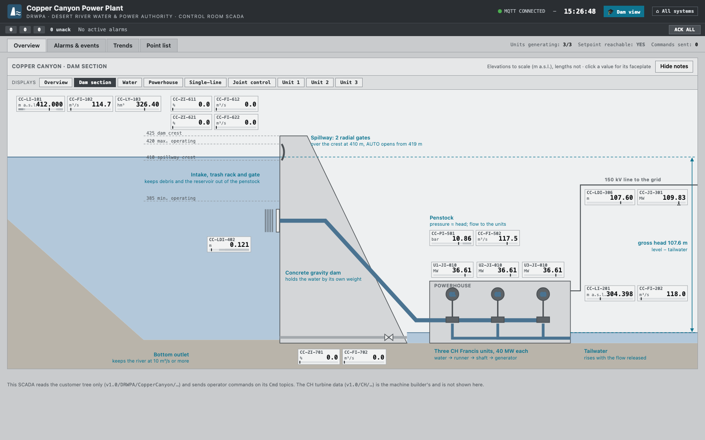
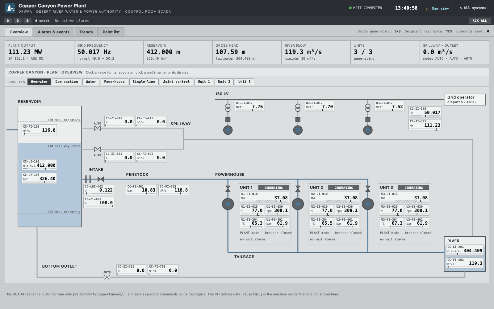
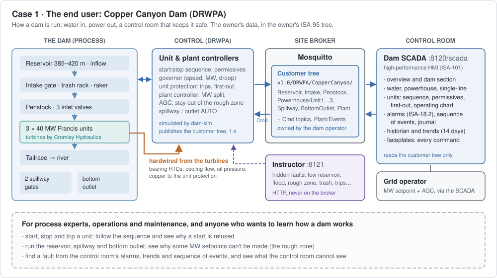
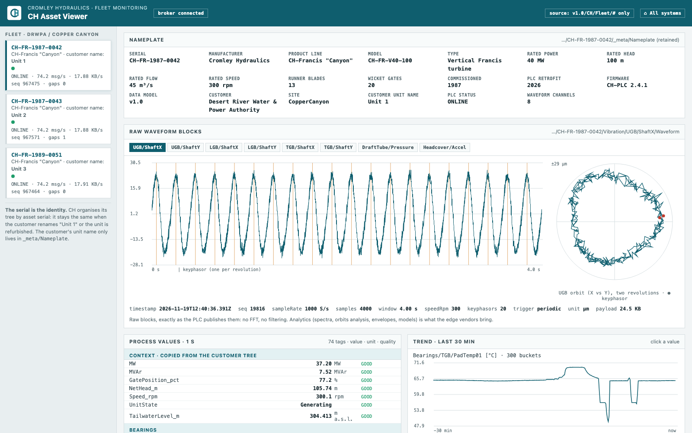
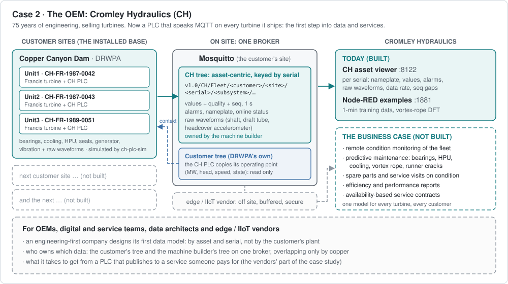
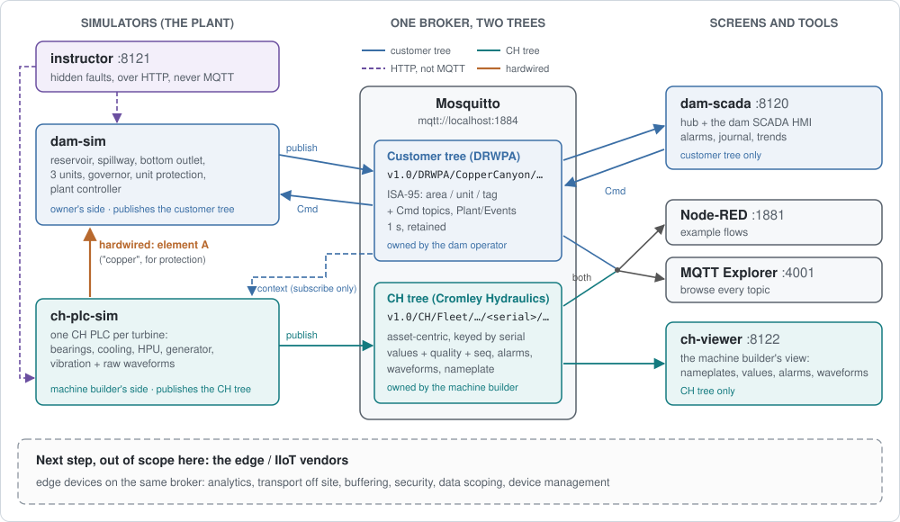

# Cromley Hydraulics — Copper Canyon Dam demo environment

> **Disclaimer.** This code is part of the [IT/OT Academy](https://itot.academy), offered by
> [The IT/OT Insider](https://itotinsider.com). It is a generated, vibe-coded system made **only for
> demo purposes**. It may not be used for anything other than demonstration or training: not in
> production, not connected to real equipment, and not as the basis for any real control, quality
> or maintenance decision.

**One environment, two cases.** A small fictional hydropower dam, **Copper Canyon Dam**, run by its
owner, and the fictional machine builder whose three turbines it runs, **Cromley Hydraulics**. Both
publish their data to one local MQTT broker, each in its own tree. You can use either case on its
own, or both together to show how they meet. It is the third ITOT.Academy environment, after
[Haltenberg](https://github.com/itotinsider/haltenberg-chemische-werke-uns) (DCS + OPC UA) and
[Sweet Harmony](https://github.com/itotinsider/sweet-harmony-treats-uns) (plant-owner UNS over MQTT).

| | Case 1 · The end user | Case 2 · The OEM |
|---|---|---|
| **Who** | Desert River Water & Power Authority (DRWPA), owner and operator of Copper Canyon Dam | Cromley Hydraulics (CH), an engineering-first turbine builder (an *OEM*) |
| **Their data** | the customer tree `v1.0/DRWPA/CopperCanyon/…` (ISA-95: area, unit, tag) | the CH tree `v1.0/CH/Fleet/…/<serial>/…` (by asset and serial number) |
| **Their screen** | the control room's dam SCADA | the CH asset viewer |
| **For** | process experts, operations, maintenance and reliability; learning how a dam works | OEMs, digital and service teams, data architects, edge / IIoT vendors |

## Case 1 · The end user: Copper Canyon Dam

A concrete gravity dam with a reservoir, one intake and penstock, three 40 MW Francis units, a
spillway with two radial gates and a bottom outlet, on a 150 kV line. DRWPA runs it from a control
room with a high-performance (ISA-101) SCADA: start, stop and trip units and follow their sequence,
manage the reservoir and spillway, take the grid operator's MW setpoint, work the alarms, trends
and sequence of events. The plant behaves like a real one: water hammer, a rough zone the plant
controller must avoid, protection on hardwired bearing temperatures, floods and low water.







New to dams? Start with [Dams and turbines in brief](https://github.com/itotinsider/cromley-hydraulics-uns/wiki/Dams-and-turbines-in-brief), then
[Copper Canyon Dam](https://github.com/itotinsider/cromley-hydraulics-uns/wiki/Copper-Canyon-Dam) and the [Dam SCADA](https://github.com/itotinsider/cromley-hydraulics-uns/wiki/Dam-SCADA).

## Case 2 · The OEM: Cromley Hydraulics

Cromley Hydraulics has built dam hydraulics for 75 years: an engineering company that sells
turbines, not data. It now fits every major turbine it ships with a modern PLC that speaks MQTT,
to move its customers from reactive to proactive maintenance, and itself from selling machines to
selling services: condition monitoring, predictive maintenance, parts and service visits on
condition. Its first data model is the machine builder's view: one asset-centric tree for the whole
fleet, keyed by serial number, with values that carry quality and a sequence number, alarms,
nameplates and raw vibration waveforms, rich enough for predictive maintenance. What turns that
into a service (analytics, transport off site, buffering, security) is what the edge / IIoT
vendors bring in the next step of the case study.





The lesson in one page: [Customer data vs. machine-builder data](https://github.com/itotinsider/cromley-hydraulics-uns/wiki/Customer-data-vs-machine-builder-data).
For vendors: the [Edge vendor brief](https://github.com/itotinsider/cromley-hydraulics-uns/wiki/Edge-vendor-brief).

## Where the two meet: one broker, two trees

Both trees sit on the same broker at the dam. The CH PLCs read their operating point from the
customer tree but never write to it; the customer's unit protection gets the CH bearing sensors
over copper (the hardwired element A), not over MQTT. Instructors inject hidden faults through the
instructor station, so either side has to find them from its own data.



More: [Architecture](https://github.com/itotinsider/cromley-hydraulics-uns/wiki/Architecture), [Namespace](https://github.com/itotinsider/cromley-hydraulics-uns/wiki/Namespace).
**📖 Everything else: [the wiki](https://github.com/itotinsider/cromley-hydraulics-uns/wiki).**

## Quick start

Needs Docker Desktop (or Docker Engine + Compose v2) and free ports 8120, 8121, 8122, 1884, 1881,
4001 (chosen so Haltenberg and Sweet Harmony can run alongside).

```bash
docker compose up -d --build
```

| What | Where |
|---|---|
| Hub (all systems) | http://localhost:8120 |
| Dam SCADA (case 1) | http://localhost:8120/scada |
| CH asset viewer (case 2) | http://localhost:8122 |
| Instructor station (hidden fault scenarios) | http://localhost:8121 |
| MQTT broker (both trees, no auth) | `mqtt://localhost:1884` |
| Node-RED | http://localhost:1881 |
| MQTT Explorer | http://localhost:4001 |

Or open Claude Code in this folder and ask: `read the CLAUDE.md file and README.md file and set up the environment`.

Then take the [15-minute first tour](https://github.com/itotinsider/cromley-hydraulics-uns/wiki/Getting-started#a-first-tour-15-minutes).

## For developers

```bash
docker compose run --rm tests                                   # all tests, ~3 min
docker compose run --rm tests python -m pytest -m "not e2e"     # without the end-to-end part
docker compose run --rm tests python tools/inventory.py         # after an intended interface change
```

- [CLAUDE.md](CLAUDE.md): how everything works, and the gotchas.
- [inventory/](inventory/README.md): every topic, command, hardwired signal, scenario and HTTP route, tested against the code.
- [ROADMAP.md](ROADMAP.md): plans and work in progress. Claim an item before you start.
- [wiki/](wiki/): the source of the wiki, published to GitHub on every merge to `main`.
  See [Development](https://github.com/itotinsider/cromley-hydraulics-uns/wiki/Development).
- The original brief: [Cromley Hydraulics – Demo Environment Design Basis.md](<Cromley Hydraulics – Demo Environment Design Basis.md>).
