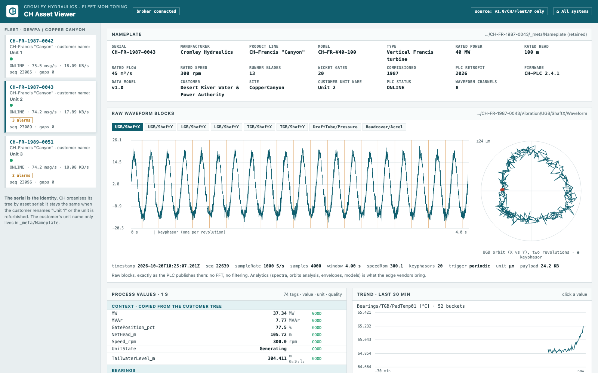
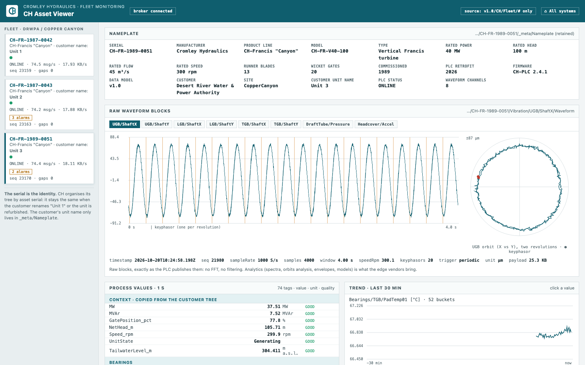

# CH asset viewer

The CH asset viewer at **http://localhost:8122** is what Cromley Hydraulics sees of its fleet. It
subscribes the CH tree only (`v1.0/CH/#`), never the customer tree. It does **no analytics**: it
shows the raw data an edge vendor starts from.

## What it shows

- **Fleet by serial:** every asset that has published, with its PLC status (`_meta/Status`,
  `ONLINE`/`OFFLINE` from the last will), active PLC alarms, messages per second, KB/s and **seq
  gaps** (missed messages, counted from `seq`).
- **Nameplate:** the retained `_meta/Nameplate`: model, ratings, commissioning year, PLC firmware,
  the customer's name for the unit, the waveform channels.
- **Process tree:** every 1 s value by subsystem, with unit, quality and age; trends per tag.
- **Events:** the PLC's alarm events (`Events/Alarm`), newest first.
- **Waveforms:** the latest raw block per channel in the time domain, with the keyphasor marks, and
  the **orbit** (Y against X) for each guide bearing. The `trigger` (`periodic`, `alarm`,
  `manual`) and the block's timestamp are shown with it.

## Deep links

| Link | Opens |
|---|---|
| `http://localhost:8122/#CH-FR-1987-0042` | One asset |
| `http://localhost:8122/#CH-FR-1987-0042/wave/Vibration/TGB/ShaftX/Waveform` | One waveform channel |

## API

| Route | |
|---|---|
| `GET /api/assets` | serial → nameplate, status, active alarms, message statistics, latest waveform per channel (timestamp, trigger, samples) |
| `GET /api/asset/<serial>` | Values (value, unit, quality, age) and the last 100 events |
| `GET /api/waveform/<serial>?path=Vibration/TGB/ShaftX/Waveform` | The full latest block |
| `GET /api/trend?serial=<serial>&paths=a,b&minutes=30&points=300` | Trend of CH tags |

To ask a PLC for a fresh set of blocks right now (trigger `manual`), use the CH PLC simulator from
inside the compose network: `POST http://ch-plc-sim:8125/api/waveforms/Unit1`.
