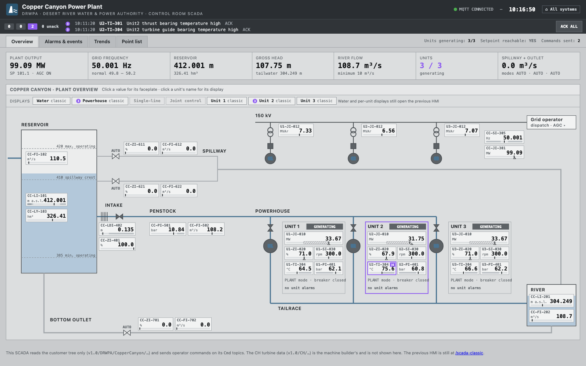
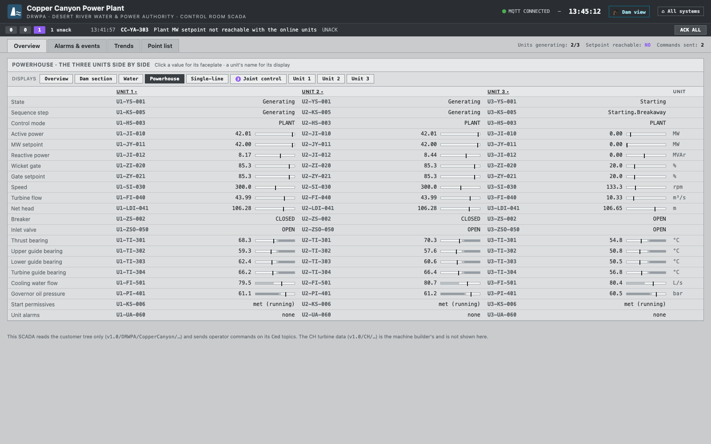
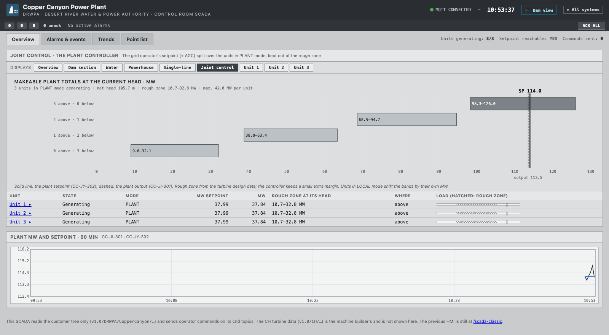
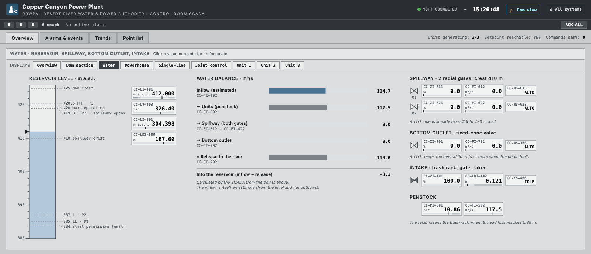
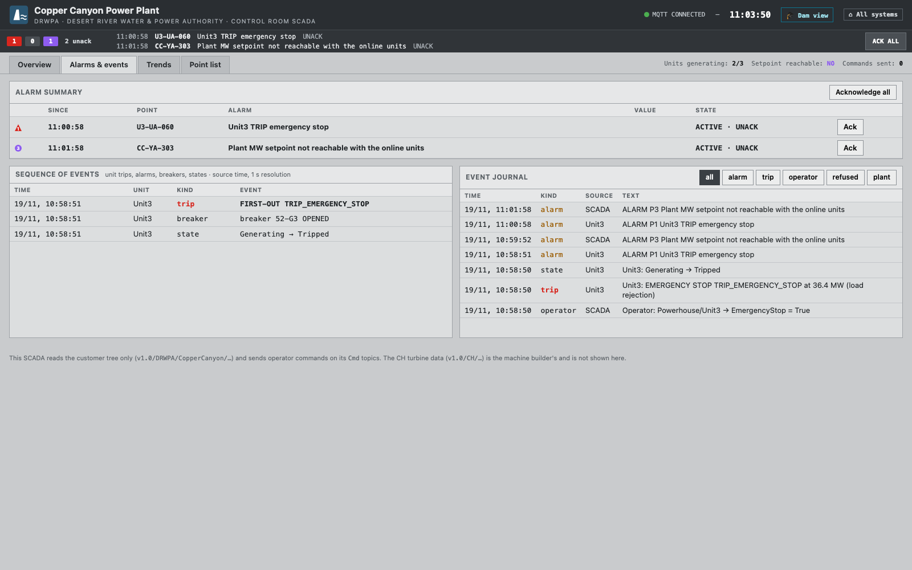

# Dam SCADA

The dam SCADA at **http://localhost:8120/scada** is the customer's supervisory system: a web HMI
that works on the customer tree only and sends operator commands back over MQTT. Real dams use
IEC 61850, DNP3 or IEC 60870-5-104 here; in this environment everything, including the grid
operator's MW setpoint, is an MQTT topic. It never reads the CH tree: that is the machine
builder's data.

It is a **high-performance HMI (ISA-101)** in the style of the HCW operator
console: a light-grey screen, colour only for alarms (priority 1 red, 2 amber, 3 violet, stale
data magenta), one muted blue for water, a point name on every value, faceplates for every
command. It replaced the previous dark HMI; that HMI's
addresses `#reservoir` and `#governor` open their successors (*Water* and *Powerhouse*).



*The plant overview in normal operation: three units generating in PLANT mode, no alarms. Grey
is normal; colour would mean an alarm.*

## Screens

| Screen | Shows | Deep link |
|---|---|---|
| Plant overview | KPI strip (plant MW and setpoint, frequency, reservoir level and its rate, gross head, river flow, units generating, spillway and outlet discharge); the flow path from reservoir to river with the spillway gates, intake, penstock, the three units, tailrace and bottom outlet; the 150 kV side (step-up transformers, breakers, generators); the grid operator | `/scada#overview` |
| Dam section (🎓 Dam view) | The dam to scale in elevation: reservoir and tailwater levels live, the gross head as a dimension, spillway gates, intake, penstock through the dam, powerhouse, bottom outlet; teal training notes on what each part does (*Hide notes* for the plain view) | `/scada#section` |
| Water | The reservoir level on a gauge against every limit (alarms, spillway crest, maximum, start permissive), level rate, volume, tailwater, head; the **water balance** (inflow, units, spillway, bottom outlet, release to the river, net into the reservoir); spillway gates, bottom outlet, intake and trash rack, penstock with their modes; 24 h trends | `/scada#water` (old `#reservoir` forwards here) |
| Single-line | The 150 kV bus, step-up transformers T1–T3, generator breakers 52-G1…G3 (filled = closed), generators with MW, MVAr, speed and state, the grid frequency and plant output; what the customer tree doesn't measure (line breaker, transformer values) is drawn dashed or marked | `/scada#sld` |
| Joint control | The plant controller: which plant totals the units in PLANT mode can make at the current head without one in the rough zone (*k above, n−k below*), with the setpoint and the output on the same axis; per unit the mode, setpoint, MW, its rough zone and where it sits; 60 min trend of output vs setpoint | `/scada#jcc` |
| Powerhouse | The three units side by side, one row per signal: state, sequence step, mode, MW and setpoint, MVAr, gate, speed, flow, head, breaker, inlet valve, the four bearing RTDs, cooling water, governor oil (with the unit's alarm and trip zones), start permissives, unit alarms | `/scada#units` |
| Unit display (Unit 1–3) | The water path (penstock, inlet valve, spiral case, wicket gates, runner, draft tube), the shaft with the four bearing RTDs, generator and breaker, governor and HPU, all as data blocks; the **sequence** step by step (S00–S11) with the current step, the **start permissives**, the **first-out** trip, the unit protection limits; the **operating chart** (MW against net head, rough zone, max. output, all three units, the last 30 min); MW and bearing trends | `/scada#unit/Unit1` |
| Alarms and events | Alarm summary (priority, time, point, text, value, state, acknowledge) and the event journal with filters | `/scada#alarms` |
| Trends | Up to 8 points picked by point name, 15 min to 48 h, cursor read-out | `/scada#trends`, `/scada?trend=CC-JI-301,CC-JY-302&range=60` |
| Point list | Every SCADA point: point name, description, value, range bar, age, alarm, customer UNS path | `/scada#points` |
| Faceplate | Opens beside any screen: value, range with alarm limits, quality and age, the object's commands, a 30-min trend, the point's names | `/scada?tag=U1-TI-304` (point name or path) |

Every value is a **data block**: point name, value, unit and a thin bar over the point's range,
with the zones beyond its alarm limits shaded and, where there is one, the setpoint as a hollow
triangle. The unit's MW bar also hatches the rough zone at the current head. A block in alarm gets
a border and badge in its priority colour; a stale block a dashed magenta border. The display bar
shows the highest active alarm on each display.


*Unit 2 tripped on generator protection: the unit, its generator and the display bar carry the P1
mark; the Unit control faceplate (a click on the unit's state) offers Reset, which the unit controller
accepts only at standstill with the inlet valve closed.*

The **🎓 Dam view** button in the header (or *Dam section* in the display bar) shows how the dam
physically looks: the cross-section of the previous HMI, redrawn in the same style, with the same
data blocks and faceplates. Teal is the training colour only (as on the HCW console): it never
means an alarm or a state.


**Commands sit on faceplates.** Click a spillway gate or the bottom outlet for AUTO/MAN and a
position, the intake gate for open/close (close is armed first, then confirmed), and the
**Grid operator** box at the end of the 150 kV line for the plant MW setpoint and AGC: it stands
for the dispatcher at the other end of the line. **Unit control** (the button on the unit display,
or a click on the generator, the state or the MW) has Start, Stop, Reset, Emergency stop, PLANT /
LOCAL and a local MW setpoint; Stop and Emergency stop are armed first, then confirmed. Start is
greyed out while a permissive is not met, and the faceplate says which.


*Unit 3 during a start, at S03 breakaway (gates at 20 %, speed rising): S01 and S02 are done, the
generator is outlined orange (in transition).*

### The unit display: sequence, permissives, first-out

A hydro operator follows a start or a stop on the **sequence**: the unit controller publishes its
step (`Powerhouse/<unit>/SequenceStep`, point `U<n>-KS-005`), finer than the unit state. A start
runs S01 cooling water check → S02 inlet valve → S03 breakaway → S04 speed-no-load and
excitation → S05 synchronise → S06 generating, about 100 s to the breaker; a stop S07 unload →
S08 close the gates → S09 coast down and brakes → S10 close the inlet valve → S00 stopped. The
time in the current step counts from when the page saw the step change.

The **start permissives** (`StartPermissives`, `U<n>-KS-006`) are what the unit controller
checks before it accepts a start: unit stopped, intake gate open, reservoir ≥ 384 m, the
hardwired signals from the turbine present, governor oil ≥ 55 bar. A *NOT MET* line explains a
refused start before anyone presses Start.

**First-out:** when a unit trips, several causes often appear at once (a bearing trip brings the
bearing alarm with it). The unit controller latches the cause that tripped the unit and lists it
first in `ActiveAlarms`; the unit display shows it as the first-out until Reset.

The **operating chart** plots MW against net head with the rough zone hatched and the maximum
output dashed, for all three units: it shows why the plant controller keeps units out of the
rough zone, and what a low reservoir (less head) does to the available output.



### Joint control: why a setpoint can be "not reachable"

At about 106 m net head a unit's rough zone is roughly 11–33 MW. With three units in PLANT mode,
the plant controller can make a total with all three above the rough zone (about 98–126 MW), or
with two above and one below (about 69–95 MW), and so on: between those bands there are **gaps**.
A setpoint in a gap (100 MW at that head, for example) can't be made without parking a unit in
the rough zone, so the controller delivers the nearest total it can and `MWSetpointReachable`
goes false (`CC-YA-303`, a P3 alarm after 60 s). The Joint control display draws the bands, the
setpoint and the output on one axis: the gap is visible. A lower reservoir (scenario H) shrinks
and shifts the bands.





## Point names: three names for one signal

Like a real control room, the SCADA has its own point names: ISA-5.1 letters and a loop number,
`CC-` for plant points and `U1-`…`U3-` for unit points. They are SCADA engineering data
(`point_names()` in [`common/namespace.py`](https://github.com/itotinsider/cromley-hydraulics-uns/blob/main/common/namespace.py),
served on `/api/config`), not part of the UNS. One turbine guide bearing RTD has three names:

| Who | Name |
|---|---|
| Control room (SCADA point) | `U1-TI-304` |
| Customer UNS (ISA-95 tree) | `v1.0/DRWPA/CopperCanyon/Powerhouse/Unit1/TurbineGuideBearingTemp` (element A) |
| Machine builder (CH tree) | `v1.0/CH/Fleet/DRWPA/CopperCanyon/CH-FR-1987-0042/Bearings/TGB/PadTemp01` (element B) |

| Letters | Meaning | Examples |
|---|---|---|
| `LI`, `FI`, `PI`, `TI`, `SI`, `ZI`, `JI` | level, flow, pressure, temperature, speed/frequency, position, power indicator | `CC-LI-101` reservoir level, `U2-FI-501` cooling water |
| `LDI` | level difference (head, trash rack loss) | `CC-LDI-306` gross head |
| `LY`, `JY`, `ZY` | calculated value or setpoint | `CC-JY-302` plant MW setpoint, `U1-ZY-021` gate setpoint |
| `HS`, `YS`, `ZS`, `ZSO`, `YA`, `UA` | mode switch, state, breaker position, valve open, state alarm, alarm word | `U1-ZS-002` breaker, `U1-UA-060` unit alarms |

## How a command travels

```
operator clicks Start ─► POST /api/cmd {"path": "Powerhouse/Unit1/Cmd/Start", "value": true}
   ─► dam-scada publishes v1.0/DRWPA/CopperCanyon/Powerhouse/Unit1/Cmd/Start  (QoS 1, not retained)
   ─► dam-sim checks the permissives, starts the sequence, reports on Plant/Events
   ─► the measured topics (State, InletValveOpen, Speed, …) show the result
```

The SCADA journals every operator command. A refused command shows up in the journal from
`Plant/Events`, with the reason.

## Alarms

The SCADA has its own alarm engine (ISA-18.2-style). An alarm is listed while active, and stays
listed after it clears until it is acknowledged (return to normal, RTN). Priorities: 1 high,
2 medium, 3 low.

**Limits on customer tags** (`ALARMS` in [`scada/main.py`](https://github.com/itotinsider/cromley-hydraulics-uns/blob/main/scada/main.py)):

| Alarm | Condition | P | Delay |
|---|---|---|---|
| `RES_LEVEL_HH` / `_H` | Reservoir > 420.5 / > 419.0 m a.s.l. | 1 / 2 | — |
| `RES_LEVEL_L` / `_LL` | Reservoir < 387.0 / < 385.0 m a.s.l. | 2 / 1 | — |
| `RIVER_FLOW_L` | River flow < 10 m³/s | 1 | 30 s |
| `TRASH_DP_H` / `_HH` | Trash rack DP > 0.5 / > 0.8 m | 3 / 2 | 10 s |
| `GRID_FREQ_H` / `_L` | > 50.2 / < 49.8 Hz | 2 | 5 s |
| `PLANT_SP_UNREACHABLE` | `Plant/MWSetpointReachable` false | 3 | 60 s |
| `PENSTOCK_P_H` | Penstock pressure > 12.5 bar | 2 | — |
| `UNIT<n>_<BEARING>_H` | A customer bearing RTD > 75 °C | 3 | 5 s |
| `UNIT<n>_GOV_OIL_L` | Governor oil pressure < 54 bar | 3 | 5 s |
| `COMM_DAM` | No fresh dam data for 5 s | 1 | — |

**Unit controller codes** from `Powerhouse/<unit>/ActiveAlarms` become alarms too: every `TRIP_*`
is priority 1; `BEARING_TEMP_HIGH`, `COOLING_WATER_FLOW_LOW`, `GOV_OIL_PRESSURE_LOW` and
`HARDWIRED_IO_FAULT` priority 2. Each code is shown on the signal it is about
(`COOLING_WATER_FLOW_LOW` on `U<n>-FI-501`, the governor oil codes on `U<n>-PI-401`,
`TRIP_OVERSPEED` on `U<n>-SI-030`); the others on the unit's alarm word `U<n>-UA-060`.

A value older than 5 s is shown as bad quality and isn't evaluated.



*A generator trip on Unit 2: the P1 trip and the P3 "setpoint not reachable" that follows it; the
sequence of events marks the first-out, the journal adds the operator's commands.*

## API

| Route | |
|---|---|
| `GET /api/state` | Every value with its age, the alarm list (each alarm with the `path` and `point` it is on), the last 40 events |
| `GET /api/config` | Tags, commands, alarm limits, `points` (SCADA point name per path), operating zones (rough zone and max MW per head), links |
| `GET /api/trend?paths=a,b&minutes=60&points=300` | Bucket means from the historian (a bucket without samples holds the last value; a stale point is a gap) |
| `GET /api/events?limit=200` | The journal (from the historian) |
| `GET /api/soe?limit=200` | Sequence of events: unit trips (with the first-out), unit alarms, breaker operations, state changes, in source time |
| `GET /api/points` | Every SCADA point: point name, path, description, unit, range, alarm limits, historized or not |
| `GET /api/historian` | Historian statistics: points, samples, first sample, size, deadband, heartbeat, retention |
| `POST /api/cmd` | `{"path": "<command path>", "value": ...}` |
| `POST /api/alarms/ack` | `{"id": "..."}` or `{"all": true}` |

```bash
curl -s -X POST -H 'Content-Type: application/json' \
  -d '{"path": "Plant/Cmd/MWSetpoint", "value": 90}' localhost:8120/api/cmd
```

## Historian and sequence of events

The SCADA keeps its own **historian** (SQLite, `data/scada_historian.db`), built like the HCW DCS
historian: every numeric customer point with **exception reporting** (stored when it moved more
than 0.1 % of its range, or after a 60 s heartbeat), a stale point stored once as a gap (bad
quality), the journal, and the sequence of events; 14 days retention. Trends go up to 7 days and
survive a restart. If the file can't be opened, the SCADA logs why and falls back to its memory
(2 h at 1 s, 48 h at 1 min).

The **sequence of events** (Alarms & events, and the last rows on each unit display) lists unit
trips, unit alarms, breaker operations and state changes with their source timestamp. The
first trip code of a unit that wasn't tripped is marked **FIRST-OUT**. The resolution is 1 s
(what the MQTT payloads carry): a real SOE recorder in the unit controller timestamps to 1 ms,
which is what separates causes that happen within the same second.

The RCA demo's `replay.sh` publishes recorded history with the current wall-clock time: the
historian stores it like live data. Delete `data/scada_historian.db` (SCADA stopped) to start clean.
The recorded history has no `SequenceStep` and `StartPermissives`: during a replay the unit display
shows both as STALE (magenta, with their age) and the Unit control faceplate keeps Start disabled.
