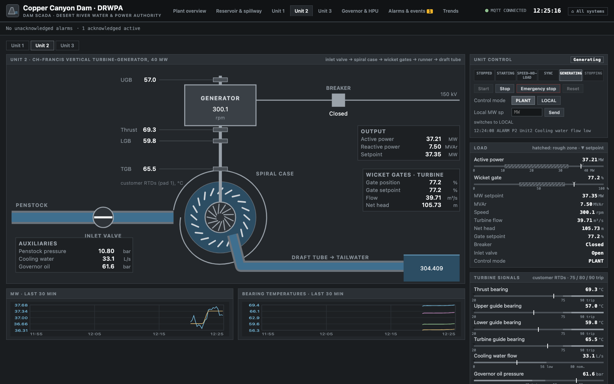
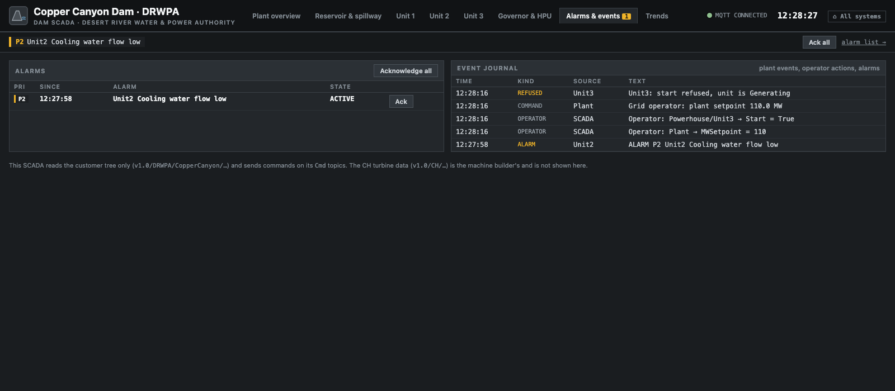

# Dam SCADA

The dam SCADA at **http://localhost:8120/scada** is the customer's supervisory system: a web HMI
that works on the customer tree only and sends operator commands back over MQTT. Real dams use
IEC 61850, DNP3 or IEC 60870-5-104 here; in this environment everything, including the grid
operator's MW setpoint, is an MQTT topic. It never reads the CH tree: that is the machine
builder's data.

Styling follows ISA-101 like Sweet Harmony's modern HMI: muted greys, saturated colour only for
alarms.


## Screens

| Screen | Shows | Deep link |
|---|---|---|
| Plant overview | Reservoir and tailwater level, head, total MW against the setpoint, river flow, status of Units 1–3, spillway and bottom outlet | `/scada#overview` |
| Reservoir and spillway | Level against the operating limits, inflow, spillway gate positions and flow, bottom outlet; gate mode and position commands | `/scada#reservoir` |
| Unit detail (Unit1–3) | Mimic from inlet valve to draft tube, state, gate position and setpoint, MW against the rough zone, speed, flow, net head, the customer's bearing temperatures and cooling water flow; start, stop, emergency stop, reset, control mode, local MW setpoint | `/scada#unit/Unit1` |
| Governor and HPU | Gate position vs. setpoint and governor oil pressure per unit | `/scada#governor` |
| Alarms and events | Active alarms by priority, acknowledge, the event journal | `/scada#alarms` |
| Trends | Any numeric customer tag, from the SCADA's in-memory trend store | `/scada#trends`, `/scada?trend=Plant/TotalMW,Plant/MWSetpoint&range=60` |



The grid operator's setpoint and AGC switch sit on the overview: they stand for the dispatcher at
the other end of the line.

## How a command travels

```
operator clicks Start ─► POST /api/cmd {"path": "Powerhouse/Unit1/Cmd/Start", "value": true}
   ─► dam-scada publishes v1.0/DRWPA/CopperCanyon/Powerhouse/Unit1/Cmd/Start  (QoS 1, not retained)
   ─► dam-sim checks the permissives, starts the sequence, reports on Plant/Events
   ─► the measured topics (State, InletValveOpen, Speed, …) show the result
```

The SCADA journals every operator command. A refused command shows up in the journal from
`Plant/Events`, with the reason.

## Alarms

The SCADA has its own alarm engine (ISA-18.2-style). An alarm is listed while active, and stays
listed after it clears until it is acknowledged (return to normal, RTN). Priorities: 1 high,
2 medium, 3 low.

**Limits on customer tags** (`ALARMS` in [`scada/main.py`](https://github.com/itotinsider/cromley-hydraulics-uns/blob/main/scada/main.py)):

| Alarm | Condition | P | Delay |
|---|---|---|---|
| `RES_LEVEL_HH` / `_H` | Reservoir > 420.5 / > 419.0 m a.s.l. | 1 / 2 | — |
| `RES_LEVEL_L` / `_LL` | Reservoir < 387.0 / < 385.0 m a.s.l. | 2 / 1 | — |
| `RIVER_FLOW_L` | River flow < 10 m³/s | 1 | 30 s |
| `TRASH_DP_H` / `_HH` | Trash rack DP > 0.5 / > 0.8 m | 3 / 2 | 10 s |
| `GRID_FREQ_H` / `_L` | > 50.2 / < 49.8 Hz | 2 | 5 s |
| `PLANT_SP_UNREACHABLE` | `Plant/MWSetpointReachable` false | 3 | 60 s |
| `PENSTOCK_P_H` | Penstock pressure > 12.5 bar | 2 | — |
| `UNIT<n>_<BEARING>_H` | A customer bearing RTD > 75 °C | 3 | 5 s |
| `UNIT<n>_GOV_OIL_L` | Governor oil pressure < 54 bar | 3 | 5 s |
| `COMM_DAM` | No fresh dam data for 5 s | 1 | — |

**Unit controller codes** from `Powerhouse/<unit>/ActiveAlarms` become alarms too: every `TRIP_*`
is priority 1; `BEARING_TEMP_HIGH`, `COOLING_WATER_FLOW_LOW`, `GOV_OIL_PRESSURE_LOW` and
`HARDWIRED_IO_FAULT` priority 2.

A value older than 5 s is shown as bad quality and isn't evaluated.



## API

| Route | |
|---|---|
| `GET /api/state` | Every value with its age, the alarm list, the last 40 events |
| `GET /api/config` | Tags, commands, alarm limits, operating zones (rough zone and max MW per head), links |
| `GET /api/trend?paths=a,b&minutes=60&points=300` | Bucket means; 1 s resolution for 2 h, then 1 min for 48 h |
| `GET /api/events?limit=200` | The journal |
| `POST /api/cmd` | `{"path": "<command path>", "value": ...}` |
| `POST /api/alarms/ack` | `{"id": "..."}` or `{"all": true}` |

```bash
curl -s -X POST -H 'Content-Type: application/json' \
  -d '{"path": "Plant/Cmd/MWSetpoint", "value": 90}' localhost:8120/api/cmd
```

Trends and the journal are kept in memory: a restart of `dam-scada` starts empty.
