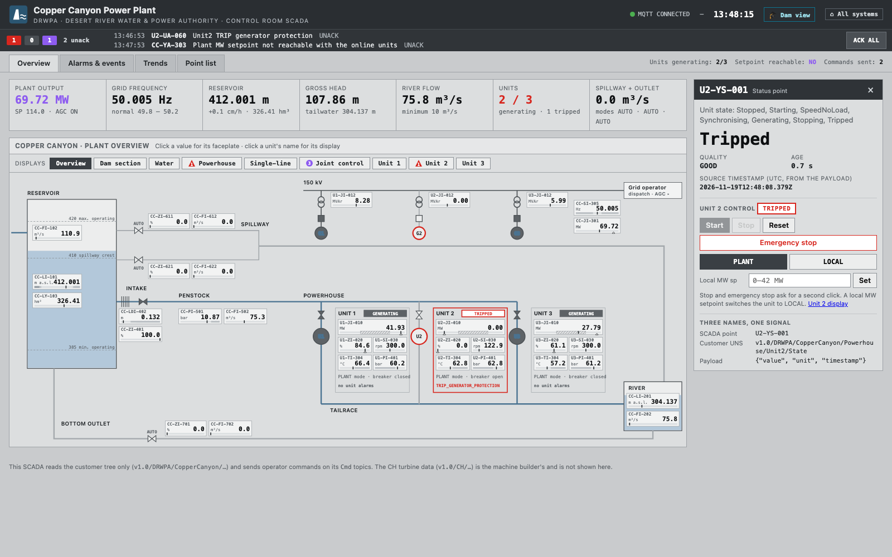
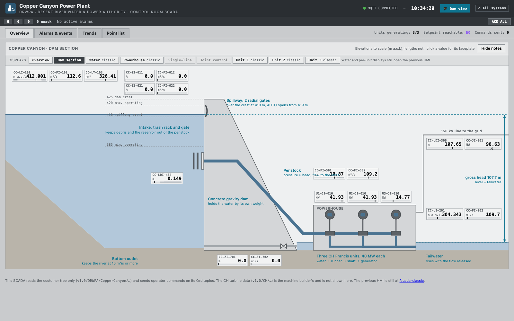
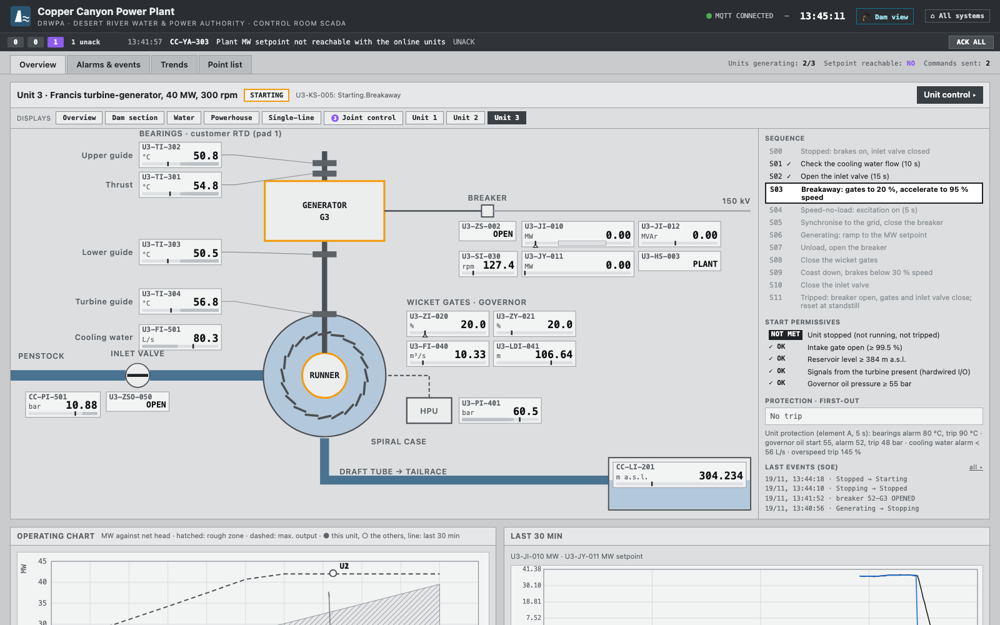

# Dam SCADA

The dam SCADA at **http://localhost:8120/scada** is the customer's supervisory system: a web HMI
that works on the customer tree only and sends operator commands back over MQTT. Real dams use
IEC 61850, DNP3 or IEC 60870-5-104 here; in this environment everything, including the grid
operator's MW setpoint, is an MQTT topic. It never reads the CH tree: that is the machine
builder's data.

It is being rebuilt as a **high-performance HMI (ISA-101)** in the style of the HCW operator
console: a light-grey screen, colour only for alarms (priority 1 red, 2 amber, 3 violet, stale
data magenta), one muted blue for water, a point name on every value, faceplates for every
command. The displays that are not rebuilt yet open the **previous HMI** at
http://localhost:8120/scada-classic (marked *classic* in the display bar).


## Screens

| Screen | Shows | Deep link |
|---|---|---|
| Plant overview | KPI strip (plant MW and setpoint, frequency, reservoir level and its rate, gross head, river flow, units generating, spillway and outlet discharge); the flow path from reservoir to river with the spillway gates, intake, penstock, the three units, tailrace and bottom outlet; the 150 kV side (step-up transformers, breakers, generators); the grid operator | `/scada#overview` |
| Dam section (🎓 Dam view) | The dam to scale in elevation: reservoir and tailwater levels live, the gross head as a dimension, spillway gates, intake, penstock through the dam, powerhouse, bottom outlet; teal training notes on what each part does (*Hide notes* for the plain view) | `/scada#section` |
| Alarms and events | Alarm summary (priority, time, point, text, value, state, acknowledge) and the event journal with filters | `/scada#alarms` |
| Trends | Up to 8 points picked by point name, 15 min to 48 h, cursor read-out | `/scada#trends`, `/scada?trend=CC-JI-301,CC-JY-302&range=60` |
| Point list | Every SCADA point: point name, description, value, range bar, age, alarm, customer UNS path | `/scada#points` |
| Faceplate | Opens beside any screen: value, range with alarm limits, quality and age, the object's commands, a 30-min trend, the point's names | `/scada?tag=U1-TI-304` (point name or path) |
| Reservoir and spillway, unit detail, governor | Still on the previous HMI: `#reservoir`, `#unit/Unit1` and `#governor` on `/scada` forward there | `/scada-classic#unit/Unit1` |

Every value is a **data block**: point name, value, unit and a thin bar over the point's range,
with the zones beyond its alarm limits shaded and, where there is one, the setpoint as a hollow
triangle. The unit's MW bar also hatches the rough zone at the current head. A block in alarm gets
a border and badge in its priority colour; a stale block a dashed magenta border. The display bar
shows the highest active alarm on each display.



The **🎓 Dam view** button in the header (or *Dam section* in the display bar) shows how the dam
physically looks: the cross-section of the previous HMI, redrawn in the same style, with the same
data blocks and faceplates. Teal is the training colour only (as on the HCW console): it never
means an alarm or a state.



**Commands sit on faceplates.** Click a spillway gate or the bottom outlet for AUTO/MAN and a
position, the intake gate for open/close (close is armed first, then confirmed), and the
**Grid operator** box at the end of the 150 kV line for the plant MW setpoint and AGC: it stands
for the dispatcher at the other end of the line. Unit commands are on the unit display (previous
HMI for now).



## Point names: three names for one signal

Like a real control room, the SCADA has its own point names: ISA-5.1 letters and a loop number,
`CC-` for plant points and `U1-`…`U3-` for unit points. They are SCADA engineering data
(`point_names()` in [`common/namespace.py`](https://github.com/itotinsider/cromley-hydraulics-uns/blob/main/common/namespace.py),
served on `/api/config`), not part of the UNS. One turbine guide bearing RTD has three names:

| Who | Name |
|---|---|
| Control room (SCADA point) | `U1-TI-304` |
| Customer UNS (ISA-95 tree) | `v1.0/DRWPA/CopperCanyon/Powerhouse/Unit1/TurbineGuideBearingTemp` (element A) |
| Machine builder (CH tree) | `v1.0/CH/Fleet/DRWPA/CopperCanyon/CH-FR-1987-0042/Bearings/TGB/PadTemp01` (element B) |

| Letters | Meaning | Examples |
|---|---|---|
| `LI`, `FI`, `PI`, `TI`, `SI`, `ZI`, `JI` | level, flow, pressure, temperature, speed/frequency, position, power indicator | `CC-LI-101` reservoir level, `U2-FI-501` cooling water |
| `LDI` | level difference (head, trash rack loss) | `CC-LDI-306` gross head |
| `LY`, `JY`, `ZY` | calculated value or setpoint | `CC-JY-302` plant MW setpoint, `U1-ZY-021` gate setpoint |
| `HS`, `YS`, `ZS`, `ZSO`, `YA`, `UA` | mode switch, state, breaker position, valve open, state alarm, alarm word | `U1-ZS-002` breaker, `U1-UA-060` unit alarms |

## How a command travels

```
operator clicks Start ─► POST /api/cmd {"path": "Powerhouse/Unit1/Cmd/Start", "value": true}
   ─► dam-scada publishes v1.0/DRWPA/CopperCanyon/Powerhouse/Unit1/Cmd/Start  (QoS 1, not retained)
   ─► dam-sim checks the permissives, starts the sequence, reports on Plant/Events
   ─► the measured topics (State, InletValveOpen, Speed, …) show the result
```

The SCADA journals every operator command. A refused command shows up in the journal from
`Plant/Events`, with the reason.

## Alarms

The SCADA has its own alarm engine (ISA-18.2-style). An alarm is listed while active, and stays
listed after it clears until it is acknowledged (return to normal, RTN). Priorities: 1 high,
2 medium, 3 low.

**Limits on customer tags** (`ALARMS` in [`scada/main.py`](https://github.com/itotinsider/cromley-hydraulics-uns/blob/main/scada/main.py)):

| Alarm | Condition | P | Delay |
|---|---|---|---|
| `RES_LEVEL_HH` / `_H` | Reservoir > 420.5 / > 419.0 m a.s.l. | 1 / 2 | — |
| `RES_LEVEL_L` / `_LL` | Reservoir < 387.0 / < 385.0 m a.s.l. | 2 / 1 | — |
| `RIVER_FLOW_L` | River flow < 10 m³/s | 1 | 30 s |
| `TRASH_DP_H` / `_HH` | Trash rack DP > 0.5 / > 0.8 m | 3 / 2 | 10 s |
| `GRID_FREQ_H` / `_L` | > 50.2 / < 49.8 Hz | 2 | 5 s |
| `PLANT_SP_UNREACHABLE` | `Plant/MWSetpointReachable` false | 3 | 60 s |
| `PENSTOCK_P_H` | Penstock pressure > 12.5 bar | 2 | — |
| `UNIT<n>_<BEARING>_H` | A customer bearing RTD > 75 °C | 3 | 5 s |
| `UNIT<n>_GOV_OIL_L` | Governor oil pressure < 54 bar | 3 | 5 s |
| `COMM_DAM` | No fresh dam data for 5 s | 1 | — |

**Unit controller codes** from `Powerhouse/<unit>/ActiveAlarms` become alarms too: every `TRIP_*`
is priority 1; `BEARING_TEMP_HIGH`, `COOLING_WATER_FLOW_LOW`, `GOV_OIL_PRESSURE_LOW` and
`HARDWIRED_IO_FAULT` priority 2. Each code is shown on the signal it is about
(`COOLING_WATER_FLOW_LOW` on `U<n>-FI-501`, the governor oil codes on `U<n>-PI-401`,
`TRIP_OVERSPEED` on `U<n>-SI-030`); the others on the unit's alarm word `U<n>-UA-060`.

A value older than 5 s is shown as bad quality and isn't evaluated.


## API

| Route | |
|---|---|
| `GET /api/state` | Every value with its age, the alarm list (each alarm with the `path` and `point` it is on), the last 40 events |
| `GET /api/config` | Tags, commands, alarm limits, `points` (SCADA point name per path), operating zones (rough zone and max MW per head), links |
| `GET /api/trend?paths=a,b&minutes=60&points=300` | Bucket means; 1 s resolution for 2 h, then 1 min for 48 h |
| `GET /api/events?limit=200` | The journal |
| `POST /api/cmd` | `{"path": "<command path>", "value": ...}` |
| `POST /api/alarms/ack` | `{"id": "..."}` or `{"all": true}` |

```bash
curl -s -X POST -H 'Content-Type: application/json' \
  -d '{"path": "Plant/Cmd/MWSetpoint", "value": 90}' localhost:8120/api/cmd
```

Trends and the journal are kept in memory: a restart of `dam-scada` starts empty. (A persistent
historian is planned in the SCADA rebuild.)
