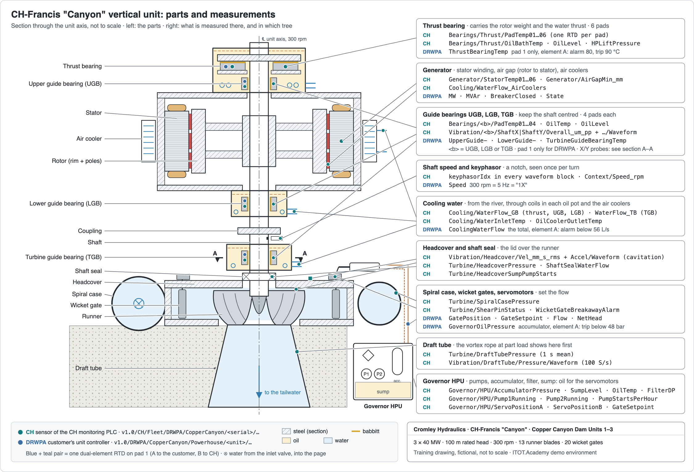
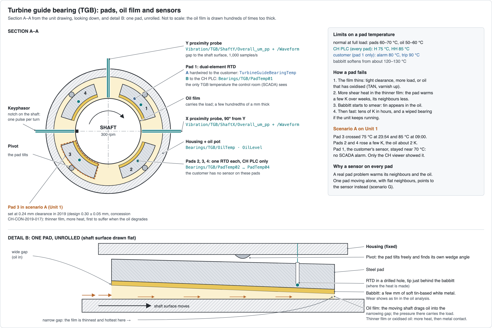

# Dams and turbines in brief

This page is for people who have never been inside a powerhouse. It explains just enough to find
your way around the rest of this wiki, the screens and the topic trees. All Copper Canyon figures
are demo assumptions.

## What a hydropower dam does

A dam holds back a river and stores the water in a **reservoir**. The height difference between
the reservoir and the river below the dam (the **tailwater**) is the **head**. Water falling
through that head drives turbines, the turbines drive generators, the generators feed the grid.

Copper Canyon Dam has two jobs at the same time:

- **generate power** when the grid needs it (the grid operator sends a MW setpoint);
- **keep room for floods**, so the dam is never overtopped (the spillway passes flood water).

And one rule that always applies: at least **10 m³/s** must flow to the river, through a running
unit or through the bottom outlet.

## The water path

```
reservoir ─► intake (trash rack, intake gate) ─► penstock ─► inlet valve ─► spiral case
          ─► wicket gates ─► runner ─► draft tube ─► river (tailwater)
```

| Part | What it does |
|---|---|
| **Trash rack** | A steel grid at the intake that stops debris. A raker cleans it when the head loss across it (TrashRackDP) grows |
| **Intake gate** | Closes the intake in an emergency or for maintenance |
| **Penstock** | The steel pipe down to the powerhouse; at Copper Canyon one 5.5 m pipe branching to three units |
| **Inlet valve** | A butterfly valve per unit that isolates it from the penstock |
| **Spiral case** | The snail-shaped casing that spreads the water evenly around the runner |
| **Wicket gates** | A ring of 20 adjustable vanes: their opening sets the flow, so the power |
| **Runner** | The turning wheel (13 blades at Copper Canyon) on the shaft to the generator |
| **Draft tube** | The widening outlet below the runner; it recovers energy and leads the water to the river |

## Power

```
P ≈ ρ · g · Q · H · η
```

ρ = 1,000 kg/m³, g = 9.81 m/s², Q the flow in m³/s, H the net head in m, η the efficiency.

At Copper Canyon one unit at rated conditions: 1,000 × 9.81 × 45 m³/s × 100 m × 0.93 ≈ **41 MW**
(about 40 MW after bearing and windage losses). Three units make ~120 MW.

- **Gross head** = reservoir level − tailwater level: 412 − 304.5 ≈ 107.5 m on a normal day.
- **Net head** = gross head minus the losses in the trash rack, penstock and branch (~2 m).
- **Efficiency** is best at ~85–90 % gate opening and drops quickly below half gate. A low
  reservoir lowers the head: the same MW then needs more water, and the units can't reach 40 MW.

## Turbine types

| Type | Head | How the flow is set | At CH |
|---|---|---|---|
| **Francis** | medium to high (20–700 m) | wicket gates; water enters radially, leaves axially into the draft tube | CH-Francis "Canyon", the three Copper Canyon units |
| **Kaplan** | low | wicket gates plus adjustable runner blades on a cam; flat efficiency curve | CH-Kaplan "Riverline" (not modelled) |
| **Pelton** | very high | needles set the jets; deflectors cut the jet on load rejection | CH-Pelton "Highpeak" (not modelled) |

## Governor, droop and AGC

The **governor** moves the wicket gates through hydraulic **servomotors**, fed with oil under
pressure by a **hydraulic power unit (HPU)**. The HPU's **accumulator** stores enough pressure for
about five full servo strokes, so the gates can always be closed, even if the pumps fail.

- **Off the grid** (starting up) the governor controls **speed**: 300 rpm at Copper Canyon
  (50 Hz, 10 pole pairs).
- **On the grid** the speed is fixed by the grid frequency, and the governor controls **power**:
  it follows a MW setpoint.
- **Droop** (5 %): a 1 % frequency drop asks for 20 % more power. Every unit on the grid helps to
  hold the frequency this way.
- **AGC** (automatic generation control): the grid operator adjusts the plant setpoint
  automatically, a few MW at a time. The **plant controller** splits the plant setpoint over the
  units.

## Start-up, shutdown, emergency stop

**Start-up:**

1. Permissives: governor oil pressure OK, cooling water flowing, intake gate open, enough water.
2. Inlet valve opens, brakes release, the high-pressure oil lift floats the thrust bearing.
3. Gates open to break-away; the unit accelerates; the governor brings it to **speed-no-load (SNL)**.
4. Field flash and excitation to rated voltage.
5. Auto-synchronise (voltage, frequency, phase) and close the generator breaker.
6. Ramp to the MW setpoint.

**Shutdown:** unload → open the breaker → close the gates → de-excite → coast down → brakes at
low speed → standstill → close the inlet valve.

**Emergency stop (trip):** the breaker opens at once, the gates close at full speed, the inlet
valve closes. It is **latched**: the operator resets it at standstill, once the cause has gone.
Causes are overspeed, electrical protection, low governor oil pressure and high bearing
temperature. Opening the breaker under load is a **load rejection**: the unit speeds up (at Copper
Canyon to ~123 %) until the gates are closed.

## Rough zone and vortex rope

A Francis runner is designed for one flow. At **part load** (~40–80 % of best-efficiency flow) the
water leaves the runner with a swirl, and a corkscrew-shaped cavity forms in the draft tube: the
**vortex rope**. It makes the draft-tube pressure pulsate at **0.2–0.4 × the runner frequency**
(at Copper Canyon 0.28 × 5 Hz = 1.4 Hz), shakes the shaft, and makes the MW swing. Operators call
this band the **rough zone** and avoid it; the plant controller does so automatically. Time spent
in the rough zone costs bearing and runner life.

## Cavitation

Where the local pressure drops below the vapour pressure, bubbles form and implode against the
runner blades. Each implosion is tiny, but over months it eats metal (**cavitation erosion**). It
gets worse at high load, at heads far from the design head, and with low tailwater (the runner sits
less deep under water). It shows as high-frequency energy in a headcover **accelerometer**.

## The unit, part by part

A Copper Canyon unit stands vertically: the generator on top, the turbine below, one shaft through
both. The drawing shows a section through the unit axis: the parts on the left, and on the right what is
measured there, and in which tree. **CH** (teal) is the CH monitoring PLC's tree, **DRWPA** (blue)
the customer's own unit controller. Most measurements exist only in the CH tree. The customer has a
handful of its own, mostly for protection.

[](images/turbine-section.png)

From top to bottom:

| Part | What it does | Measured (CH tree, unless marked) |
|---|---|---|
| **Thrust bearing** | Carries the weight of the rotating parts plus the downward water thrust, on 6 pads in an oil pot. At start and stop a high-pressure oil lift floats it | `Bearings/Thrust/PadTemp01…06`, oil bath temperature and level, lift pressure; DRWPA: `ThrustBearingTemp` (pad 1) |
| **Guide bearings** (UGB, LGB, TGB) | Keep the shaft centred: upper and lower generator guide, turbine guide. 4 pads each | `Bearings/<b>/PadTemp01…04`, oil temperature and level, shaft X/Y vibration; DRWPA: pad 1 of each |
| **Generator** | Rotor (rim with field poles) turning inside the stator (the winding the power comes out of). Between them the **air gap** | `Generator/StatorTemp01…06`, `Generator/AirGapMin_mm`; DRWPA: `MW`, `MVAr`, `BreakerClosed` |
| **Air coolers** | Water-to-air coolers around the stator | `Cooling/WaterFlow_AirCoolers` |
| **Coupling** | Bolted flange between the generator shaft and the turbine shaft | — |
| **Keyphasor** | A notch on the shaft and a probe that sees it once per turn: the reference for vibration phase | `keyphasorIdx` in the waveform blocks; DRWPA: `Speed` |
| **Shaft seal** | Keeps the water in the turbine from running up the shaft; fed with clean seal water | `Turbine/ShaftSealWaterFlow` |
| **Headcover** | The heavy lid over the runner; it carries the TGB | `Turbine/HeadcoverPressure`, headcover vibration and accelerometer |
| **Spiral case, stay vanes** | Spread the water evenly round the runner | `Turbine/SpiralCasePressure` |
| **Wicket gates, servomotors** | Set the flow; two servomotors turn the gate ring, shear pins protect each gate | `Turbine/ShearPinStatus`, `Governor/HPU/ServoPositionA/B`; DRWPA: `GatePosition` |
| **Runner** | 13 blades; turns the water's energy into torque | — (seen through vibration and the draft tube) |
| **Draft tube** | Slows the water down on its way to the river; the vortex rope lives here | `Turbine/DraftTubePressure` and its waveform |
| **Governor HPU** | Pumps, accumulator, filter, sump: oil under pressure for the servomotors | `Governor/HPU/*`; DRWPA: `GovernorOilPressure` |
| **Cooling water** | River water through coils in each oil pot and the air coolers | `Cooling/WaterFlow_GB`, `WaterFlow_TB`, inlet and outlet temperature; DRWPA: `CoolingWaterFlow` (total) |

Where a sensor appears in both trees (pad 1 of each bearing, the total cooling flow, the
accumulator pressure) it is one **dual-element** sensor: element A is wired to the customer's
protection, element B to the CH PLC. See
[Customer data vs. machine-builder data](Customer-data-vs-machine-builder-data).

## Bearings, pads and cooling

The big bearings of a hydro unit are not ball or roller bearings. A guide bearing is a ring of
separate curved blocks, the **pads** (or segments), around the shaft. Each pad is faced with a few
millimetres of **babbitt**, a soft white metal that is mostly tin. The pads never touch the shaft: the
turning shaft drags oil into the narrowing gap in front of each pad and builds an **oil film**, a
few hundredths of a millimetre thick, that carries the load. The pad sits on a **pivot**, so it tilts
to the right wedge angle by itself. The thrust bearing works the same way, with its pads lying flat
under a collar on the shaft.

[](images/turbine-bearing.png)

- **One RTD per pad**, in a hole drilled in the pad steel, with its tip just behind the babbitt where
  the heat is made. Only **pad 1** has a dual-element RTD, so the customer's SCADA sees one pad per bearing; the CH PLC
  sees them all.
- **Two proximity probes** per guide bearing, 90° apart (X and Y), measure the gap to the shaft
  surface: the shaft's movement in its bearing (see the next section).
- **Oil and cooling:** each bearing has its own oil pot with a cooling coil. Thrust, UGB and LGB share
  the generator-bearing cooling circuit (GB, 12 L/s); the TGB has its own turbine-bearing circuit
  (TB, 8 L/s); the air coolers take 60 L/s.
- **Normal and limits:** pads 60–70 °C at full load, oil bath 50–60 °C. The CH PLC alarms every pad
  at 75 °C (H) and 85 °C (HH); the customer alarms pad 1 at 80 °C and trips at 90 °C. Babbitt softens
  from about 120–130 °C.
- **How a pad fails:** the film thins (a tight clearance, more load, or oxidised oil), the thinner
  film makes more heat, the pad warms slowly over weeks, then the babbitt starts to smear (tin shows
  in the oil analysis) and the temperature runs away in hours. The classic predictive-maintenance
  case.
- **Neighbours tell you whether it is real:** a real pad problem also warms the next pads and
  the oil. One pad moving alone with flat neighbours points to the sensor instead.

In **scenario A** this happens to Unit 1's TGB pad 3, set tighter than tolerance in 2019. Pad 3 passes
85 °C while pad 1, the only pad the control room sees, stays near 70 °C. The
[RCA demo walkthrough](RCA-demo-walkthrough) follows it from the control room to the RCA.

## Vibration in one paragraph

Two **proximity probes** per guide bearing, 90° apart (X and Y), measure how far the shaft moves
in its bearing. A **keyphasor** marks one point on the shaft every revolution. **1X** is the
vibration at running speed (5 Hz): mostly **unbalance**. **2X** points to **misalignment**. Plotting
Y against X gives the **orbit**: a circle for pure unbalance, an ellipse or figure-eight for
misalignment. Sub-synchronous vibration below 1X at a hydro unit is usually the vortex rope.

## Words you will meet

| Term | Meaning | Where here |
|---|---|---|
| **Head** (gross / net) | Height the water falls, before / after losses | `Plant/GrossHead`, `Powerhouse/<unit>/NetHead` |
| **Tailwater** | River level below the powerhouse | `River/TailwaterLevel` |
| **m a.s.l.** | Metres above sea level | Reservoir and tailwater levels |
| **Wicket gates** | Adjustable vanes that set the flow | `GatePosition` (customer), `Context/GatePosition_pct` (CH) |
| **Spiral case** | Casing that feeds the runner | `Turbine/SpiralCasePressure` |
| **Headcover** | The cover over the runner | `Turbine/HeadcoverPressure`, `Vibration/Headcover/*` |
| **Draft tube** | Outlet below the runner | `Turbine/DraftTubePressure`, its waveform |
| **Penstock** | Pipe from intake to powerhouse | `Penstock/Pressure`, `Penstock/Flow` |
| **Water hammer** | Pressure surge when the flow changes fast | Penstock pressure on a trip |
| **Governor** | Speed/power controller moving the gates | `GateSetpoint` |
| **HPU** | Hydraulic power unit: pumps, accumulator, sump | `Governor/HPU/*` |
| **Accumulator** | Pressurised oil store for the servomotors | `Governor/HPU/AccumulatorPressure` |
| **Servomotor** | Hydraulic cylinder moving the gate ring | `Governor/HPU/ServoPositionA/B` |
| **Shear pin** | Weak link between a gate and its ring; breaks if a gate jams | `Turbine/ShearPinStatus` |
| **Droop** | Power-frequency slope of a governor (5 %) | — |
| **AGC** | Automatic generation control from the grid operator | `Plant/AGCEnabled` |
| **SNL** | Speed-no-load: at rated speed, breaker open | State `SpeedNoLoad` |
| **Load rejection** | Breaker opens under load | `Counters/LoadRejections` |
| **Rough zone** | Part-load band with the vortex rope | Unit MW bars on the SCADA |
| **Keyphasor** | Once-per-revolution mark | `keyphasorIdx` in waveform blocks |
| **1X, 2X** | Vibration at 1× and 2× running speed | Shaft waveforms |
| **Orbit** | Y vs. X shaft displacement | CH asset viewer |
| **Blade pass** | Runner blades × speed: 13 × 5 = 65 Hz | Headcover accelerometer |
| **RTD** | Resistance temperature detector | Every bearing pad temperature |
| **Pad** (segment) | One block of a bearing, faced with babbitt, floating on the oil film | `Bearings/<b>/PadTemp01…` |
| **Babbitt** | Soft tin-based white metal on the pad face; wear shows as tin in the oil | Oil analysis (RCA demo library) |
| **Air gap** | Gap between generator rotor and stator | `Generator/AirGapMin_mm` |
| **Dual-element RTD** | One sensor, two elements: one to the customer, one to CH | [Customer data vs. machine-builder data](Customer-data-vs-machine-builder-data) |
