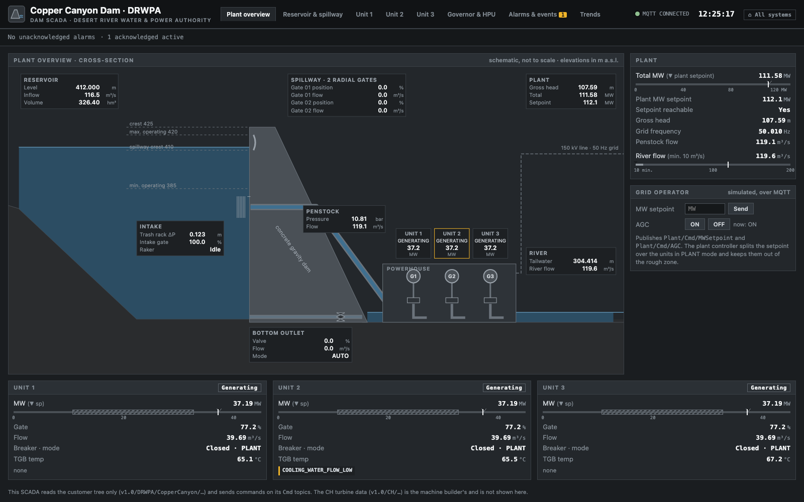

# Getting started

## Easiest way

Open Claude Code in the repository folder and run this prompt:

```
read the CLAUDE.md file and README.md file and set up the environment
```

## Prerequisites

- Docker Desktop (or Docker Engine + Compose v2)
- Free host ports. They are chosen so Haltenberg and Sweet Harmony can run at the same time:

| Service | Port |
|---|---|
| Hub + dam SCADA | 8120 |
| Instructor station | 8121 |
| CH asset viewer | 8122 |
| Mosquitto (MQTT) | 1884 |
| Node-RED | 1881 |
| MQTT Explorer | 4001 |

Ports taken? Set other ones in a `.env` file, see [Configuration](Configuration).

## Start

```bash
git clone https://github.com/itotinsider/cromley-hydraulics-uns.git
cd cromley-hydraulics-uns
docker compose up -d --build
```

Then open the hub at **http://localhost:8120**. The dam starts at steady state: all three units
generating, the plant at its 110 MW setpoint. No start-up procedure is needed.

| What | Where |
|---|---|
| Hub (all systems) | http://localhost:8120 |
| Dam SCADA | http://localhost:8120/scada |
| Unit detail (e.g. Unit 1) | http://localhost:8120/scada#unit/Unit1 |
| Instructor station (fault scenarios) | http://localhost:8121 |
| CH asset viewer | http://localhost:8122 |
| MQTT broker | `mqtt://localhost:1884` (anonymous, no TLS) |
| MQTT Explorer | http://localhost:4001 (click **Connect** on "Copper Canyon Dam") |
| Node-RED | http://localhost:1881 |
| Bearing pads, 1-min averages (CSV, written by Node-RED) | `exports/ch_bearings_1min.csv` |



## A first tour (15 minutes)

New to dams? Read [Dams and turbines in brief](Dams-and-turbines-in-brief) first.

1. Open the **dam SCADA** from the hub. The overview shows the reservoir and tailwater level, the
   head, the total MW against the grid operator's setpoint, the river flow and the state of
   Units 1–3, the spillway and the bottom outlet.
2. Open **Unit 1**: the water path from the inlet valve to the draft tube, gate position, MW, speed,
   and the customer's own bearing temperatures and cooling water flow.
3. Open **MQTT Explorer** and connect. You see two trees on one broker: `v1.0/DRWPA/CopperCanyon`
   (the customer) and `v1.0/CH/Fleet/DRWPA/CopperCanyon/<serial>` (the machine builder). Compare
   `Powerhouse/Unit1/TurbineGuideBearingTemp` with
   `CH-FR-1987-0042/Bearings/TGB/PadTemp01` … `PadTemp04`.
4. Open the **CH asset viewer** at http://localhost:8122. Pick `CH-FR-1989-0051` (Unit 3): the
   nameplate, the process tree with quality and seq, and a raw shaft waveform with its orbit.
5. Open the **instructor station** at http://localhost:8121 and start **F. Mechanical unbalance
   after maintenance** on **Unit 3**.
6. In the CH viewer, watch `Vibration/UGB/ShaftX/Overall_um_pp` jump from ~45 to ~150 µm pp and the
   PLC raise `VIB_UGB_X_ALERT`. The next waveform block (every 30 s, or right away with the alarm
   trigger) shows a bigger, phase-shifted orbit. The dam SCADA sees nothing: the customer has no
   vibration probes.
7. Try the opposite: start **B. Cooling-water strainer blockage** on **Unit 2**. Now the customer
   notices first: the SCADA raises *Unit2 Cooling water flow low* within about 4 minutes, then the
   thrust bearing temperature alarms (SCADA limit 75 °C after ~12 minutes, the unit controller's
   80 °C after ~18). Left alone, the unit trips on bearing temperature (90 °C).
8. Recover: on the instructor station press **Stop** on each scenario ("repair"). If a unit
   tripped, reset it on the SCADA unit display once it is at standstill, then start it again.

## Stop / reset

```bash
docker compose down                 # stop
rm data/ch_plc_counters.json        # reset the turbine counters (starts, run hours, trips)
rm mosquitto/data/mosquitto.db      # forget retained messages (last values, nameplates, status)
```

The dam itself always restarts at its design operating point. The SCADA and the CH viewer keep
trends in memory only, so a restart starts with empty trends.

After any code or web change: `docker compose up -d --build` (files are copied into the images).
