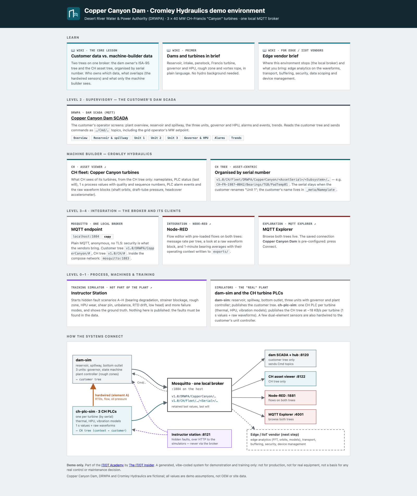

# Cromley Hydraulics — Copper Canyon Dam demo environment

> **Disclaimer.** This code is part of the [IT/OT Academy](https://itot.academy), offered by
> [The IT/OT Insider](https://itotinsider.com). It is a generated, vibe-coded system made **only for
> demo purposes**. It may not be used for anything other than demonstration or training: not in
> production, not connected to real equipment, and not as the basis for any real control, quality
> or maintenance decision.

**Cromley Hydraulics (CH)** is a fictional machine builder with 75 years of dam hydraulics
experience and an engineering-first culture. Its turbines used to be delivered, integrated into
the customer's control system and forgotten. CH now fits every major turbine with a modern PLC
that speaks MQTT, to move from reactive to proactive maintenance and to explore a data-driven
business model.

The environment is **Copper Canyon Dam**, a small fictional hydropower dam run by the fictional
Desert River Water & Power Authority (DRWPA): one reservoir, one intake and penstock, three 40 MW
CH Francis turbines, a spillway and a bottom outlet. Everything talks to **one local Mosquitto
broker, over MQTT only**.

## What it is for

CH is the third ITOT.Academy environment. It teaches the **machine-builder view** of industrial
data:

- the customer's own **ISA-95 tree** (`v1.0/DRWPA/CopperCanyon/...`), published by the dam and
  used by the dam SCADA, which also sends its commands over MQTT;
- next to it, on the same broker, the **CH asset tree** (`v1.0/CH/Fleet/...`), organised by turbine
  serial number: 1 s process values with quality and sequence numbers, plus raw vibration and
  pressure **waveform blocks**;
- hidden **machine faults** on slow and fast timescales, rich enough for edge and IIoT vendors to
  show predictive maintenance on the same data.

The environment stops at the broker. Edge devices, analytics, transport, buffering, security and
device management are what the vendors bring: see the [Edge vendor brief](Edge-vendor-brief).

## Where to start

| You want to… | Read |
|---|---|
| Run it on your laptop | [Getting started](Getting-started) |
| Understand dams, turbines, governors, vibration | [Dams and turbines in brief](Dams-and-turbines-in-brief) |
| Know the site and how it is operated | [Copper Canyon Dam](Copper-Canyon-Dam) |
| See how the pieces fit | [Architecture](Architecture) |
| Understand the core lesson | [Customer data vs. machine-builder data](Customer-data-vs-machine-builder-data) |
| Find a topic | [Namespace](Namespace), [Interface reference](Interface-reference) |
| Use the screens | [Dam SCADA](Dam-SCADA), [CH asset viewer](CH-asset-viewer), [Instructor station](Instructor-station) |
| Show your edge platform on it | [Edge vendor brief](Edge-vendor-brief), [Failure modes](Failure-modes) |
| Discuss the business case | [Business model](Business-model) |
| Change the code | [Development](Development) |

## Compared with the other environments

| Aspect | [Haltenberg (HCW)](https://github.com/itotinsider/haltenberg-chemische-werke-uns) | [Sweet Harmony (SHT)](https://github.com/itotinsider/sweet-harmony-treats-uns) | Cromley Hydraulics (CH) |
|---|---|---|---|
| Story | Air separation unit run by a DCS | Industrial bakery, many PLCs/HMIs/SCADAs | Machine builder monitoring its turbines at a customer dam |
| Connectivity | Modbus TCP plant to DCS, OPC UA out | MQTT (Mosquitto) | MQTT only, one local Mosquitto |
| Namespace | OPC UA address space | ISA-95 `v1.0/SHT/Munich/...` + `_RAW` feed | Customer ISA-95 tree + CH asset-centric tree on the same broker |
| Payload | OPC UA nodes | `{value, unit, timestamp}` | Same; the CH tree adds `quality` and `seq`, plus waveform blocks |
| Training hook | Instructor station, hidden faults | Hidden anomaly injection | Instructor station, hidden machine faults on slow and fast timescales |

Plans and work in progress are in
[ROADMAP.md](https://github.com/itotinsider/cromley-hydraulics-uns/blob/main/ROADMAP.md). The
original brief is the
[design basis](https://github.com/itotinsider/cromley-hydraulics-uns/blob/main/Cromley%20Hydraulics%20%E2%80%93%20Demo%20Environment%20Design%20Basis.md).
