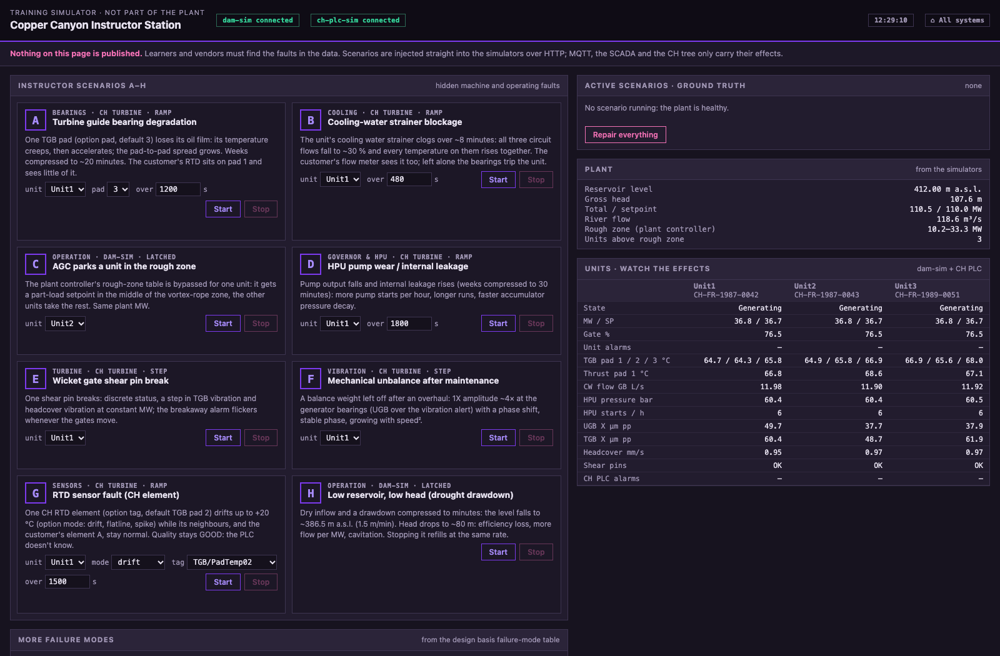

# Instructor station

The instructor station at **http://localhost:8121** is the simulator side of the glass. It is
deliberately dark and violet, so nobody mistakes it for the dam SCADA. It starts and stops the
hidden fault scenarios and shows the simulators' ground truth.



**Hidden faults.** The instructor station talks to the dam simulator and the CH PLC simulator
directly over HTTP, never through the broker. Nothing in MQTT says that a scenario is active:
learners and vendors diagnose from the data alone. Don't show this page to the people who are
supposed to find the fault.

## Scenarios A–H

| | Scenario (id) | Failure mode | Target | Speed | What changes | Who notices first |
|---|---|---|---|---|---|---|
| A | Turbine guide bearing degradation (`tgb_bearing_degradation`) | #1 | a unit | weeks → ~20 min | One TGB pad (option `pad`, default 3) creeps, then accelerates (~64 → ~95 °C); neighbours follow a little, the oil ~1–2 K; late on, the TGB 1X grows | **CH**: PLC alarms at 75 / 85 °C. The customer's pad-1 RTD rises ~3 K |
| B | Cooling-water strainer blockage (`cooling_strainer`) | #2 | a unit | ~8 min | All three cooling circuits fall to ~30 %; every bearing and the stator warm together | **Both**: customer `COOLING_WATER_FLOW_LOW` within ~4 min; left alone, a bearing trip after ~25–30 min |
| C | AGC parks a unit in the rough zone (`agc_rough_zone`) | #7 | a unit (default Unit2) | live | The plant controller's rough-zone table is bypassed for that unit: it gets ~22 MW at ~55 % gate, the others take the rest. Same plant MW | **CH**: draft-tube pulsation at ~1.4 Hz, sub-synchronous shaft vibration, headcover vibration. The customer sees a unit at part load with swinging MW |
| D | HPU pump wear / internal leakage (`hpu_pump_wear`) | #11 | a unit | weeks → 30 min | Pump output −55 %, leakage ×4: faster accumulator decay, more and longer pump runs | **CH**: `PumpStartsPerHour` trend (rolling hour, so it lags), dP/dt of `AccumulatorPressure` |
| E | Wicket gate shear pin break (`shear_pin`) | #10 | a unit | instant | `ShearPinStatus` = `BROKEN`; TGB vibration and headcover vibration step up at constant MW; `WicketGateBreakawayAlarm` while the gates move | **CH**: PLC `SHEAR_PIN_BROKEN` (critical) and alarm-triggered waveforms |
| F | Mechanical unbalance after maintenance (`unbalance`) | #4 | a unit | step | 1X ×4.2 at UGB, ×3.4 at LGB, ×1.8 at TGB with a 60° phase shift; UGB above the vibration alert | **CH** only: the customer has no vibration probes |
| G | RTD sensor fault (`rtd_fault`) | #15 | a unit | ~25 min | One CH RTD element (option `tag`, default `Bearings/TGB/PadTemp02`) drifts up to +20 °C; option `mode`: `drift`, `flatline`, `spike`. Quality stays `GOOD` | **CH**, if it cross-checks neighbours. The customer's element A is fine |
| H | Low reservoir, low head (`low_reservoir`) | #8 + efficiency | the plant | ~17 min | Inflow drops, the level falls 1.5 m/min to ~386.5 m a.s.l., head to ~82 m: lower efficiency, more flow per MW, gates near 100 %, more cavitation; 110 MW is no longer reachable | **Both**: SCADA reservoir alarms and `MWSetpointReachable` false; CH headcover vibration and accelerometer bursts |

Stopping H refills the reservoir at the same compressed rate.

## Further scenarios

| Scenario (id) | Failure mode | Effect |
|---|---|---|
| Oil cooler fouling (`cooler_fouling`) | #2 | Heat transfer halves over 30 min; flows stay normal, oil hotter, cooler outlet colder |
| TGB oil contamination (`oil_water_ingress`) | #3 | TGB oil level +8 %, oil temperature +3 K over 30 min |
| Misalignment / bearing clearance (`misalignment`) | #5 | 2X grows, orbits turn elliptical (LGB, TGB), over 10 min |
| Hydraulic unbalance (`hydraulic_unbalance`) | #6 | A 1X component that grows with gate opening, not speed, over 10 min |
| Runner blade crack (`runner_crack`) | #9 | Blade-pass harmonics (2 × 65 Hz, sidebands ±1X) grow in the headcover accelerometer and TGB probes, over 30 min |
| Servomotor seal leak (`servo_seal_leak`) | #12 | HPU sump level drops, servo B lags the setpoint, over 30 min |
| Shaft seal wear (`shaft_seal_wear`) | #13 | Seal water flow, headcover sump pump starts and headcover pressure rise, over 30 min |
| Generator air-gap anomaly (`air_gap`) | #14 | Minimum air gap shrinks from ~11.6 to ~9.5 mm over 30 min (PLC alarm below 10.5) |
| Flood inflow (`flood`) | — | Level brought near 420 m (compressed), inflow 1,200 m³/s: the spillway opens in AUTO. Stopping restores the level |
| Generator protection trip (`generator_trip`) | — | Instant load rejection and emergency stop of one unit (default Unit1); reset at standstill |
| Debris on the trash rack (`trash_debris`) | — | Trash rack DP rises 40× faster for 15 min; the raker can't keep up |

Ramp scenarios accept an option `duration_s` to change the compression. The failure-mode numbers
refer to [Failure modes](Failure-modes).

## Repair

**Stop** on a scenario "repairs" it at once: the fault term is gone, but the physics still has to
recover (a hot bearing cools with its time constant). **Reset all** stops every scenario on every
unit. A unit that tripped must still be reset and restarted from the [dam SCADA](Dam-SCADA).

## API

```bash
curl -s localhost:8121/api/scenarios | python3 -m json.tool | head -40
curl -s -X POST -H 'Content-Type: application/json' -d '{"unit":"Unit1"}' \
  localhost:8121/api/scenarios/tgb_bearing_degradation/start
curl -s -X POST -H 'Content-Type: application/json' \
  -d '{"unit":"Unit1","options":{"mode":"flatline","tag":"Bearings/TGB/PadTemp03"}}' \
  localhost:8121/api/scenarios/rtd_fault/start
curl -s -X POST -H 'Content-Type: application/json' -d '{"unit":"Unit1"}' \
  localhost:8121/api/scenarios/tgb_bearing_degradation/stop
curl -s localhost:8121/api/ground_truth | python3 -m json.tool
curl -s -X POST localhost:8121/api/reset
```

| Route | |
|---|---|
| `GET /api/scenarios` | Every scenario, dam and CH, with letter, group, target and options |
| `GET /api/ground_truth` | Active scenarios with their severity, the plant controller's internals, the PLC alarms |
| `GET /api/overview` | A few live values per unit, for orientation |
| `POST /api/scenarios/<id>/start` | `{"unit": "Unit1", "options": {...}}` (409 if already running) |
| `POST /api/scenarios/<id>/stop` | `{"unit": "Unit1"}` |
| `POST /api/reset` | Stop everything |
