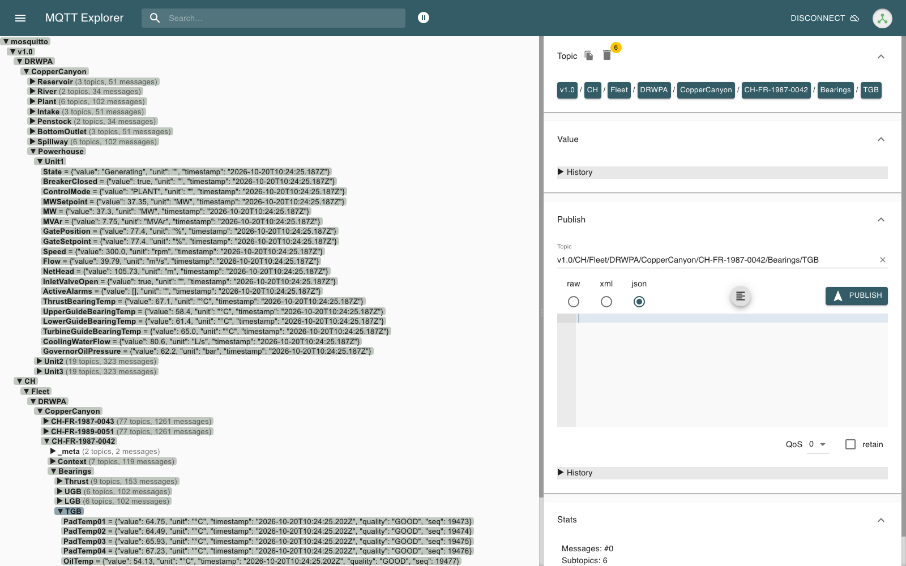
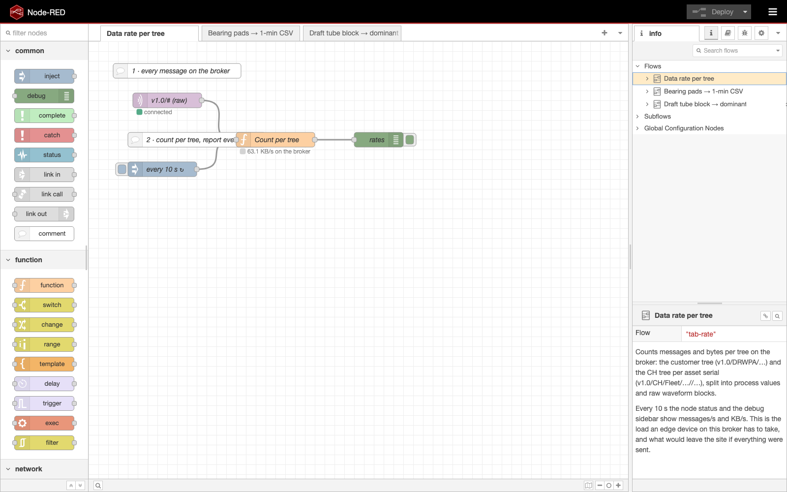

# Node-RED and MQTT Explorer

Two generic tools on the broker, for exploring both trees and building quick flows.

## MQTT Explorer

http://localhost:4001 — the browser build of [MQTT Explorer](https://mqtt-explorer.com/). One
connection is pre-seeded: **Copper Canyon Dam**, host `mosquitto`, port 1883 (the browser UI
connects server-side, inside the compose network), subscribed to `v1.0/DRWPA/#` and `v1.0/CH/#`.
Click **Connect**.

Things to look at:

- the two roots side by side: `v1.0/DRWPA/CopperCanyon` (by plant area) and
  `v1.0/CH/Fleet/DRWPA/CopperCanyon` (by serial);
- a CH value's `quality` and `seq`;
- `_meta/Nameplate` and `_meta/Status` (retained);
- a waveform block: one message of ~25 KB with 4,000 samples;
- the `Cmd` topics: publish one yourself, e.g. `v1.0/DRWPA/CopperCanyon/Plant/Cmd/MWSetpoint`
  with payload `90` (not retained!), and watch `Plant/MWSetpoint` follow.

The connection is stored in `mqtt_explorer_data/settings.json`, which is tracked in git as that
one-connection seed. Connections you add in the UI land in the same file: **never commit them**
(they store passwords in plain text).

## Node-RED

http://localhost:1881 — the official Node-RED image with the flows in
[`nodered_data/flows.json`](https://github.com/itotinsider/cromley-hydraulics-uns/blob/main/nodered_data/flows.json),
using only the core MQTT nodes. Every tab has numbered comment nodes that explain it.

| Tab | Does |
|---|---|
| **Data rate per tree** | Subscribes `v1.0/DRWPA/#` and `v1.0/CH/#` and shows messages/s and KB/s per tree and per CH serial every 10 s. What a vendor has to size the link for |
| **Bearing pads → 1-min CSV** | Averages every pad temperature of each turbine per minute, with MW, cooling water temperature and flow, and appends one row per turbine to `exports/ch_bearings_1min.csv`. Training data for an L3 model (expected pad temperature vs. operating point) |
| **Draft tube block → dominant frequency (example only)** | Takes each 1,000-sample draft-tube block and runs a simple DFT in a function node; shows the dominant frequency and its amplitude. During scenario C it finds the vortex rope at ~1.4 Hz |

The third tab is edge-vendor territory, shown as an example of what an edge device does with a raw
block — not as the way to do it.

Flows edited in the browser are saved to `nodered_data/flows.json`; only that file is tracked.
