# RCA demo walkthrough

A complete run of the root cause analysis (RCA) demo, scenario A: a turbine guide bearing (TGB)
pad on Unit 1 overheats over three weeks, the shift stops the unit, and the next morning the
reliability engineer hands the case to an AI co-analyst (Claude Code). This page shows what each
person saw and did, which documents exist, and what the bot came back with.

> **Spoiler:** this page tells the whole story, including the answer. Presenters only. The bot
> never sees it, nor `rca-demo/ANSWER-KEY.md`.

Everything is fictional and for training only. Times are plant time, MST (UTC−7).

## The cast and the steps

| Who | Role | In this demo |
| --- | --- | --- |
| Marcus Bell | Shift supervisor A, control room | Sees the alarm, works through OP-07, stops Unit 1 |
| Shift C (Jake Lindqvist) | Night shift | Doesn't see the first alarm |
| Nora Fenwick | I&C on call | Helps with the OP-07 checks by phone |
| Priya Nandakumar | Reliability engineer, on leave until 4 Nov | Starts the RCA on 4 Nov with the bot |
| The RCA bot | Claude Code with the DRWPA library and the historian export | Writes the draft RCA report |

1. **[The history](#1-three-weeks-of-history):** three weeks of plant data, recorded with both simulators.
2. **[The control room](#2-the-control-room-2-and-3-november):** what the SCADA and the CH viewer
   showed, replayed on the real screens.
3. **[The shift log](#3-the-shift-log):** what the supervisor wrote.
4. **[The library](#4-the-document-library):** the documents and records the RCA works from.
5. **[The RCA](#5-the-rca-the-reliability-engineer-and-the-bot):** the prompt, what the bot does,
   the report and the grade.

## 1 Three weeks of history

`rca-demo/build/record_history.py` runs the dam and turbine models together, faster than real time
(about 75 minutes for 13 Oct – 3 Nov 2026). It follows the library's story: Unit 2's annual
inspection (18–22 Oct), a cooling-water strainer clean on Unit 3 after rain (21 Oct), weekday
evening peaks at 120 MW, and from 06:00 on 3 Nov a regulation reserve trial that holds Unit 2 at
part load, so Units 1 and 3 carry more.

On top of that runs the failure: Unit 1 TGB pad 3 slowly loses its oil film from 14 Oct, faster
from 1 Nov. Pad 3 is the pad that was set too tight in 2019 and runs in oxidised oil. The recording
is committed as gzipped CSV in `rca-demo/history/scenario-A/historian/`: 1-minute averages for the
whole period, 1-second values from 08:00 on 3 Nov, the SCADA event journal and the CH PLC alarm log.

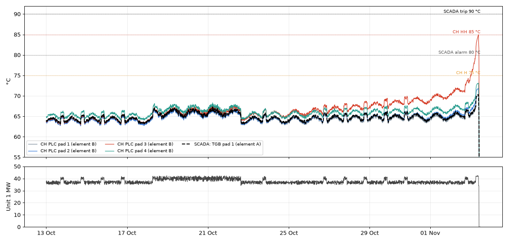

*Coloured: the four pads as the CH monitoring PLC measures them. Dashed black: the only TGB
temperature the control room has, pad 1 (element A of a dual-element sensor). Pad 3 (red) pulls
away from about 22 Oct; the control room's reading barely moves. The step on 18 Oct is load: Unit 1
carries more while Unit 2 is out.*

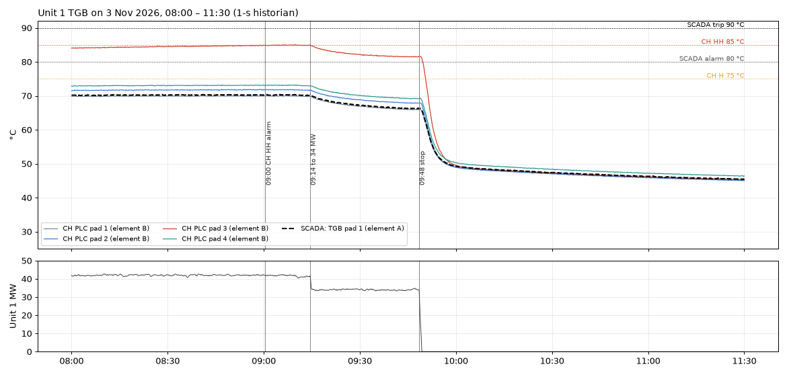

*The event day. Pad 3 reaches the CH high-high limit (85 °C) at 09:00:29. The shift reduces load at
09:14 and stops the unit at 09:48. After the stop pad 3 cools to its neighbours' temperature within
about 10 minutes: a real hot pad, not a faulty sensor. The control room's alarm (80 °C) and trip
(90 °C) were never close.*

## 2 The control room, 2 and 3 November

The control room has two screens for Unit 1:
- **The dam SCADA**, DRWPA's own system. It shows one temperature per bearing (pad 1, element A)
  and has the alarm list, horn and journal.
- **The CH asset viewer**, installed with the Cromley Hydraulics monitoring PLC retrofit in
  September. It shows every pad and the CH PLC alarms, but it has no horn and no acknowledge, and
  nobody is assigned to watch it.

The screenshots below come from `rca-demo/replay.sh`, which plays the recorded history on the
running stack (see [Replay it yourself](#replay-it-yourself)). The clock on the screens is the wall
clock of the replay; the plant time is in each heading.

### 2 Nov 23:54: pad 3 passes 75 °C

The CH PLC raises `TGB_PAD03_H`. On the SCADA, Unit 1 runs normally at 37 MW with the TGB at
65.7 °C, and there are no alarms.

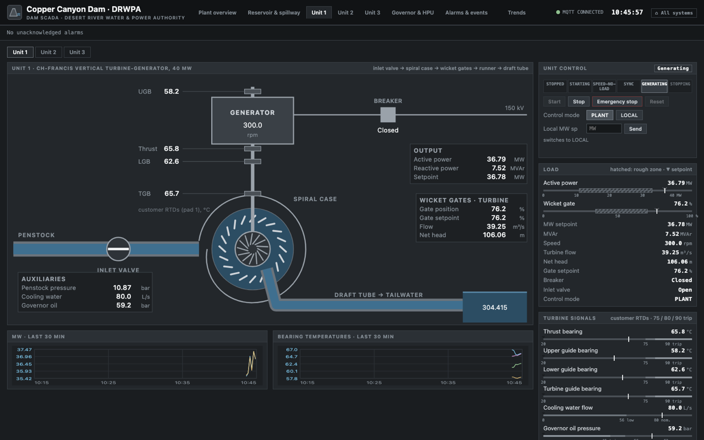

The CH viewer marks Unit 1 with "1 alarm" and lists it. Nobody on the night shift looks.

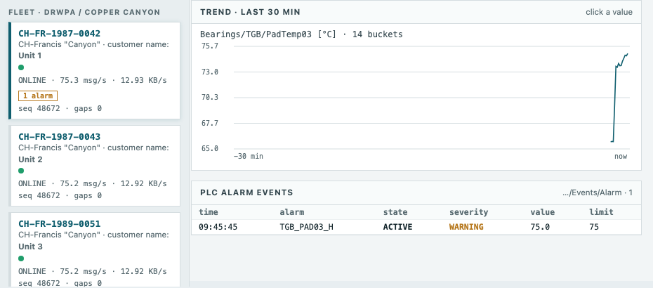

### 3 Nov 06:00–07:14: the trial starts, "No alarms"

At 06:00 the plant controller moves Unit 2 to part load for the trial and Units 1 and 3 go to about
42 MW. Unit 1's TGB on the SCADA rises from about 67 to 70 °C: higher load, still normal. At 07:13
the supervisor writes "All units generating. No alarms." The SCADA has none. The viewer has had one
for more than seven hours, and pad 3 is at 84 °C.

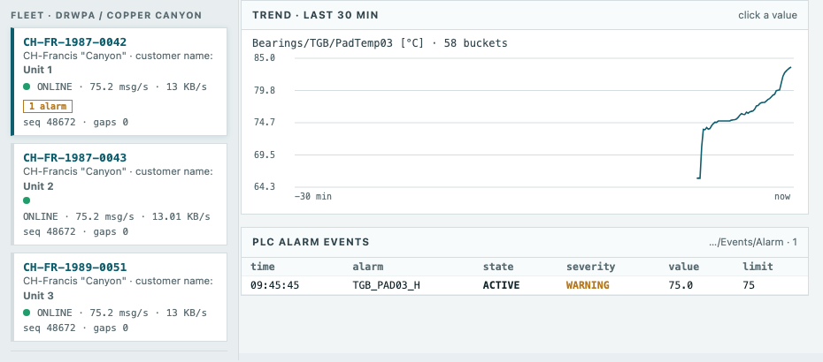

### 3 Nov 09:00: high-high

Pad 3 reaches 85 °C (`TGB_PAD03_HH`). The SCADA still shows Unit 1 at 42 MW, TGB 70.4 °C, and
"No unacknowledged alarms".


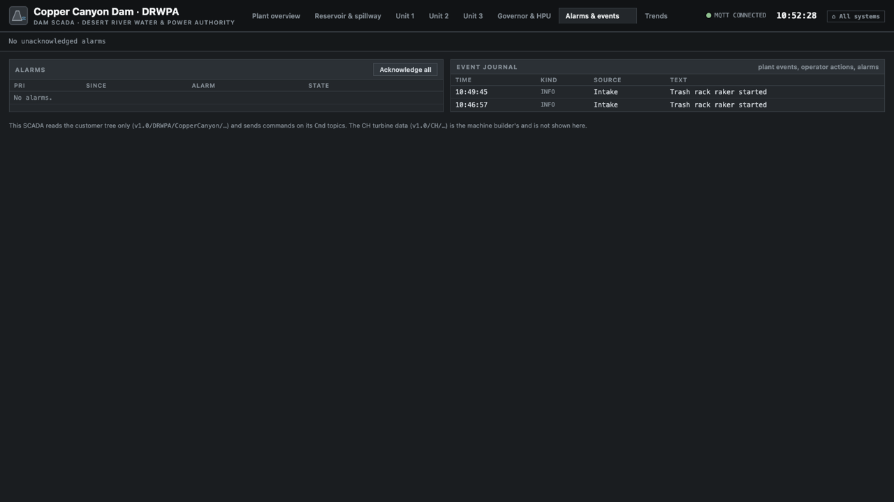

*The SCADA alarm list and journal at 09:01: nothing about Unit 1.*

The plant overview shows the trial: Unit 2 at 23 MW and 55 % gate, inside the rough zone; Units 1
and 3 at 42 MW.

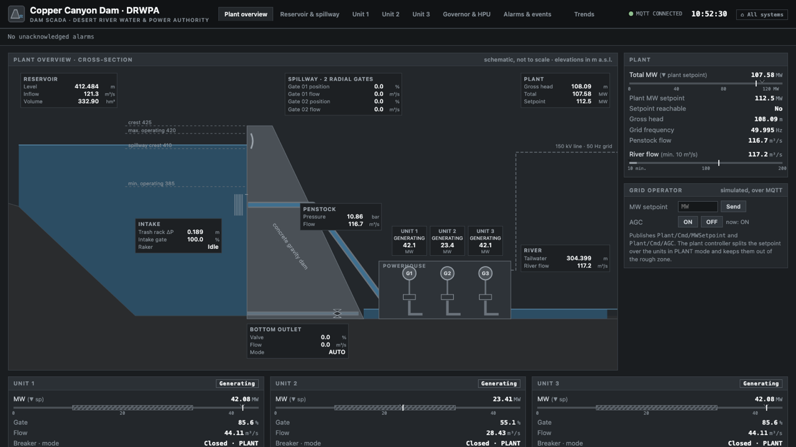

On the CH viewer the badge turns red: "2 alarms", HH critical.

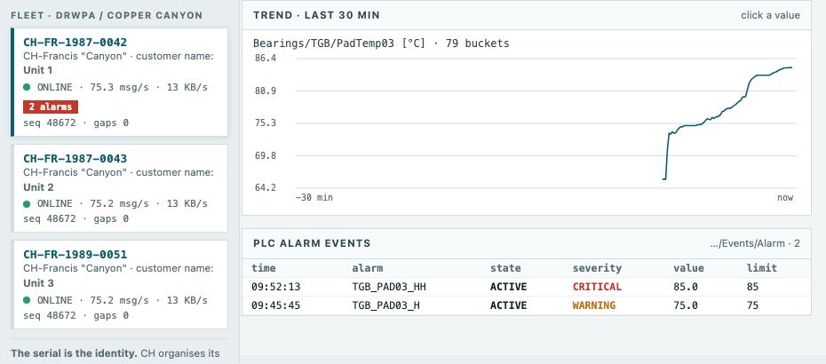

### 3 Nov 09:03–09:51: found by chance, OP-07, controlled stop

At 09:03 Marcus Bell opens the CH viewer to check Unit 2's vibration for the trial and sees the
red badge. Then DRWPA-OP-07 (bearing temperature alarm response): with Nora Fenwick on the phone,
the supervisor checks the neighbouring pads, the oil, the two elements of pad 1, cooling, the
operating point and vibration, concludes "bearing problem", reduces Unit 1 to 34 MW at 09:14, and
stops it at 09:48 when pad 3 stays above 81 °C. The SCADA journal shows only the operator's commands and the
state changes; there is still no bearing alarm in the control room's alarm system.

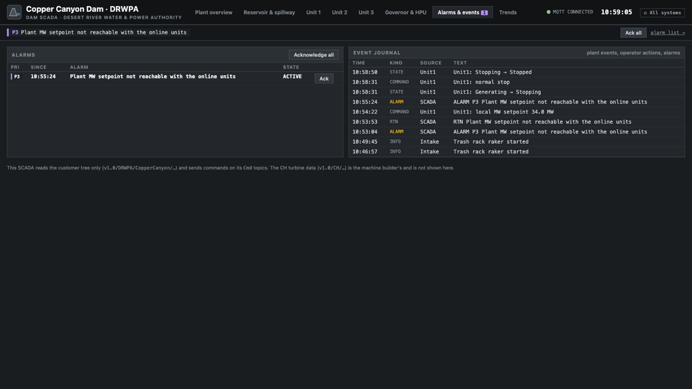

*The P3 alarm is the plant controller: with Unit 1 stopped and Unit 2 in the trial, the plant can't
make its setpoint.*

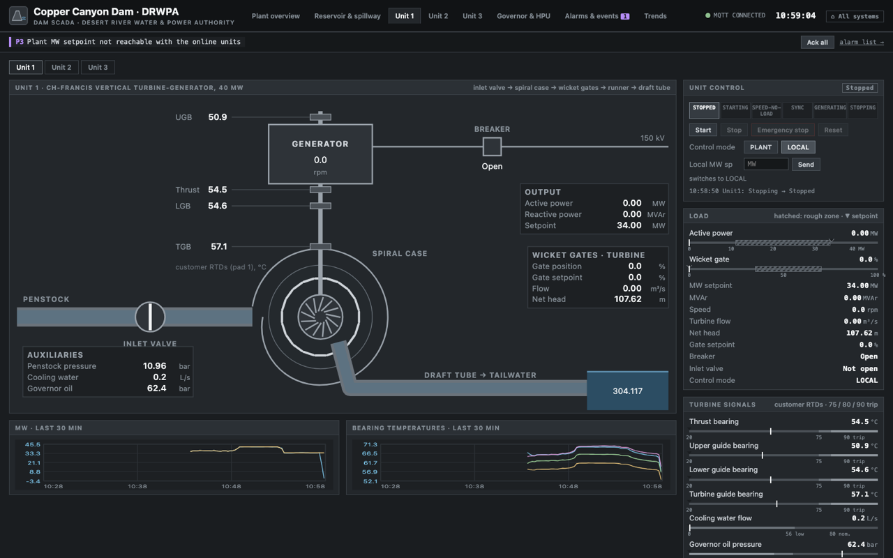

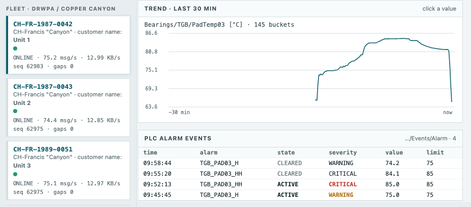

*The viewer's alarm list now shows both alarms coming and going: HH cleared at 09:16 after the
load reduction, H cleared at 09:50 as the stopped unit cooled.*

### What the operator saw, in one table

| Plant time | SCADA (control room) | CH viewer (second screen) | Shift log |
| --- | --- | --- | --- |
| 2 Nov 23:54 | TGB 65.7 °C, no alarm | pad 3 H (75 °C), badge | nothing: unseen |
| 3 Nov 06:00 | trial: Unit 1 to 42 MW, TGB to ~70 °C | pad 3 ~80 °C | 06:05 trial started |
| 07:13 | no alarm | H alarm still standing, pad 3 84 °C | "No alarms" |
| 09:00:29 | TGB 70.4 °C, no alarm | pad 3 HH (85 °C), red badge | |
| 09:03–09:14 | | OP-07 checks | found by chance; checks |
| 09:14:30 | Unit 1 to 34 MW | HH clears 09:16 | load reduced |
| 09:48–09:51 | stopping → stopped | H clears 09:50 | controlled stop |

## 3 The shift log

The shift log (`library/drwpa/records/shift-log_2026-09_2026-11.csv`) is the only record of what
the people did. The 3 Nov entries:

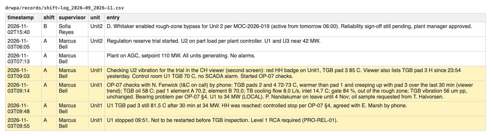

Two clues sit in it: the 07:13 "No alarms" while the H alarm had been standing for seven hours,
and "found by chance while checking Unit 2". Both point to the same latent root: the CH alarms are
on a screen nobody owns.

## 4 The document library

`rca-demo/library/` is what DRWPA's maintenance and reliability team has on file, and all the bot
gets besides the historian. Every document is fictional, generated by `rca-demo/build/` from
Markdown sources and deterministic generators.

### Supplier documents (Cromley Hydraulics, PDF)

| Document | What the RCA needs from it |
| --- | --- |
| `CH-DOC-OM-0101` O&M manual, rev 4 | TGB clearance 0.30 ± 0.05 mm; pad limits (H 75, HH 85 °C); "protection acts on pad 1 only… bring the CH PLC pad alarms into the control room"; oil limits (Caution, Action); oil change at the latest every 36 months; troubleshooting table "one pad rising, neighbours a little: oil-film loss" vs. "one pad alone: measurement fault" |
| `CH-DOC-DWG-0102` schematics, rev 2 | Sensor arrangement, cooling circuits, RTD wiring: element A to the owner, element B to the CH PLC, junction box JB-x-04 in the headcover pit |
| `CH-SB-2026-03` service bulletin | RTD connector moisture in wet junction boxes: the alternative explanation that has to be ruled out |

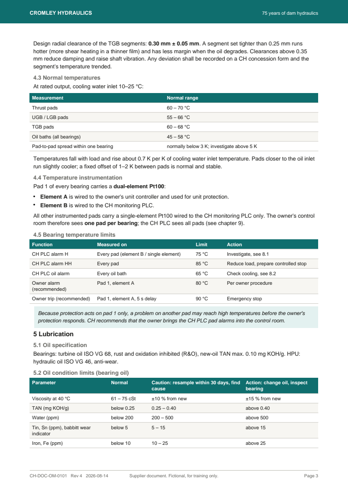

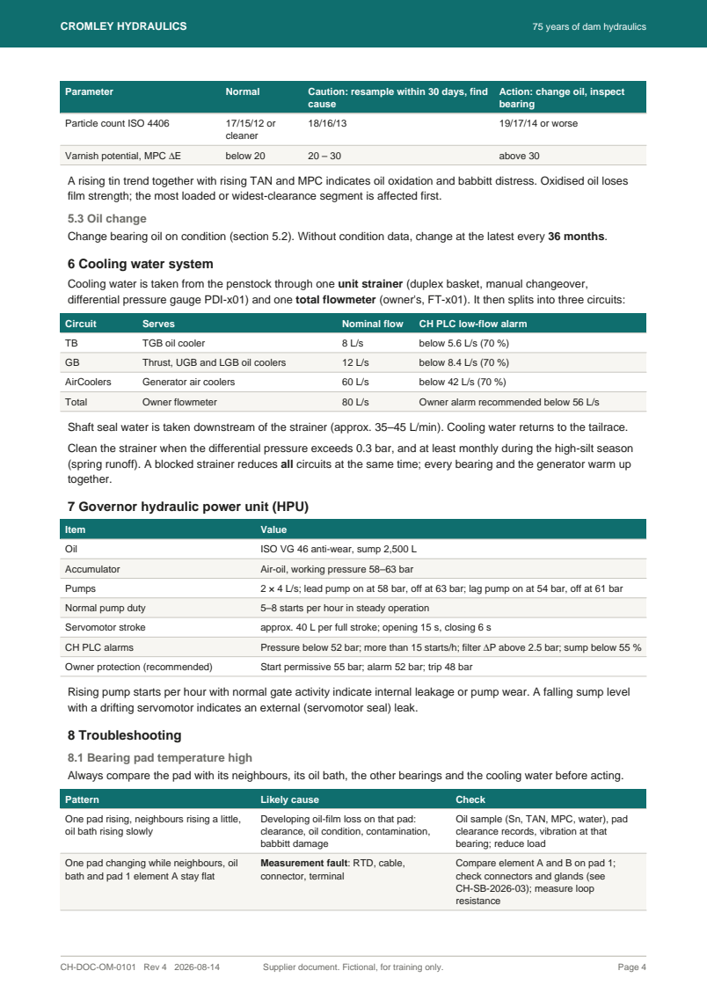

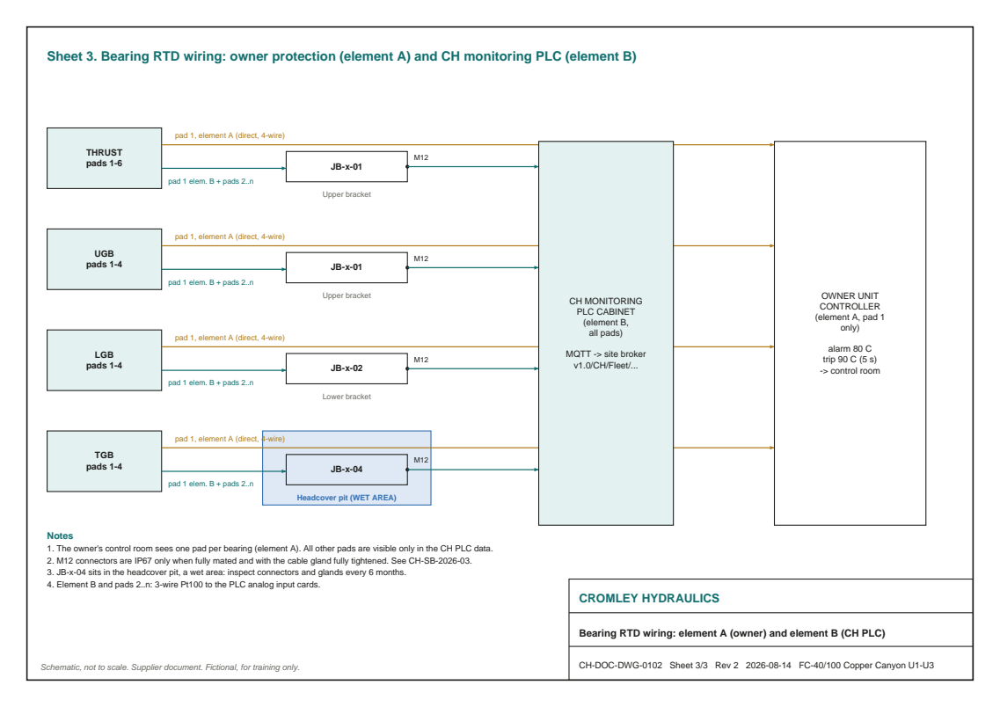

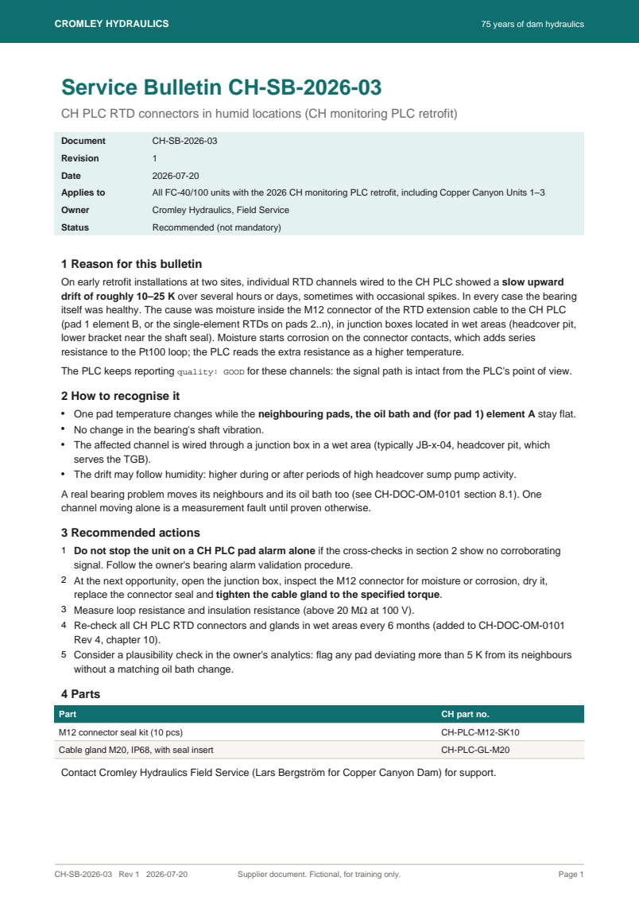

### DRWPA records (CSV)

| Record | What it holds for this case |
| --- | --- |
| `asset-register.csv` | Unit 1 TGB re-babbitted in 2019, pad 3 at 0.24 mm on concession CH-CON-2019-017 ("trend pad 3 temperature") |
| `fmeca_ch-francis-unit.csv` | FM-01 TGB overheating: the bot's hypotheses come from here |
| `pm-plan.csv` | Oil sampling every 6 months and change every 48 months (CH: quarterly, 36 months) |
| `work-orders_2021-2026.csv` | The cancelled oil change, the one resample, the deferred resample, the pad 4 punch item |
| `oil-analysis_2021-2026.csv` | Unit 1 TGB oil at "Caution" since February 2025, tin rising to 14.2 ppm |
| `moc-register.csv` | MOC-2025-004 (oil intervals extended, raised and approved by the same person, reliability condition not incorporated); MOC-2026-019 (the Unit 2 trial, sign-off pending) |
| `shift-log_2026-09_2026-11.csv` | See [above](#3-the-shift-log) |

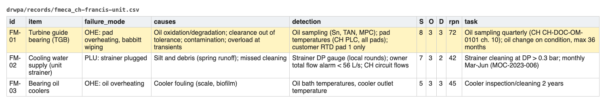

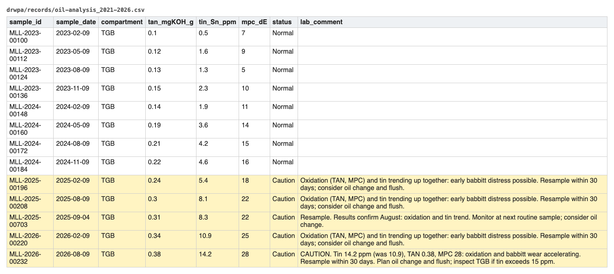

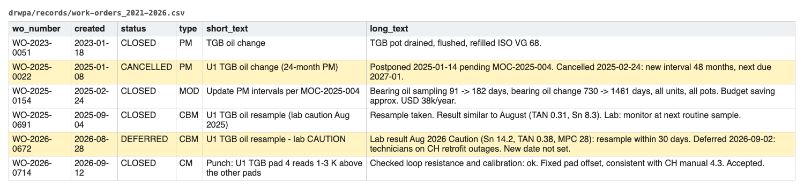

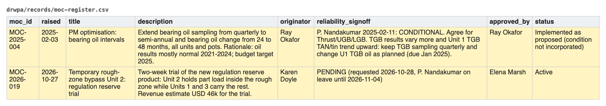

### DRWPA procedures (Markdown) and previous RCAs (PDF)

| Document | Role |
| --- | --- |
| `DRWPA-PRO-REL-01` RCA procedure | Triggers (Level 1/2/3), steps, failure coding: the bot follows it |
| `DRWPA-FRM-REL-02` RCA report template | The bot writes its report in it |
| `DRWPA-OP-03` unit operation and rough zone | Rough-zone rules and the bypass condition (reliability sign-off) |
| `DRWPA-OP-07` bearing temperature alarm response | What the shift did; rev 2 adds the CH PLC alarms "in the CH asset viewer" |
| `RCA-2023-004` | Unit 2 TGB trip from cooling-water loss: the obvious but wrong analogy |
| `RCA-2024-011` | Unit 3 stopped on a false temperature: why OP-07 exists |
| `RCA-2025-007` | Unit 2 draft tube cracks: a change went live without reliability sign-off, the latent root that repeats |

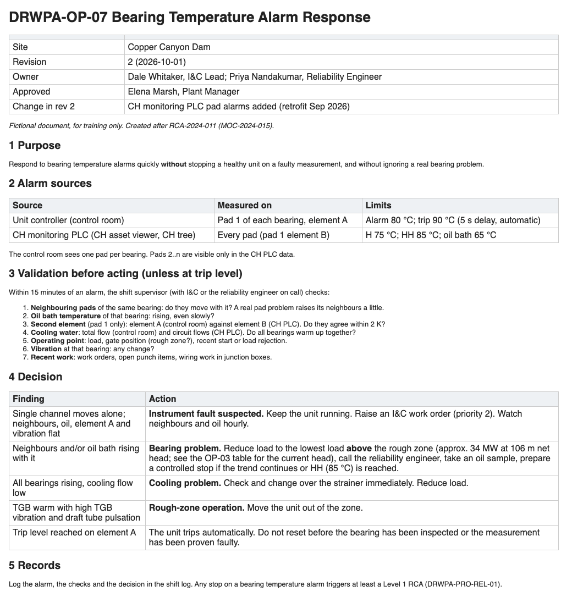

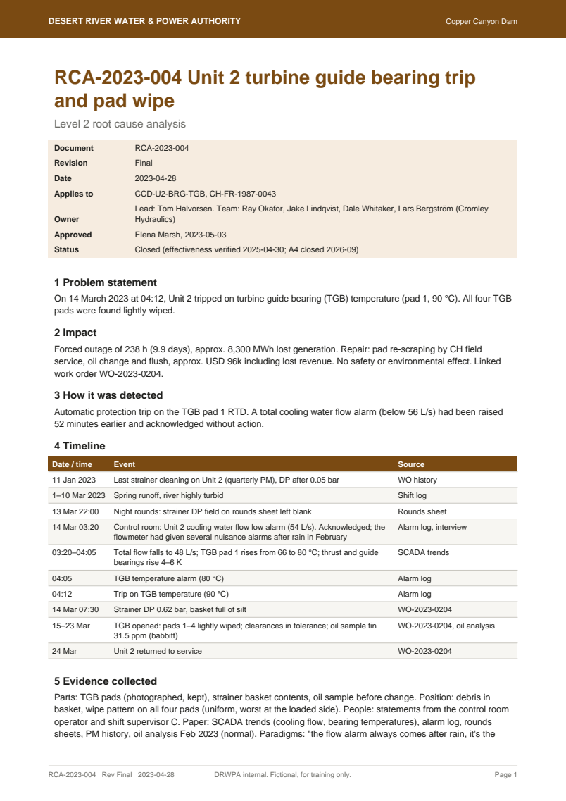

## 5 The RCA: the reliability engineer and the bot

On 4 Nov Priya Nandakumar is back from leave. Unit 1 is stopped, and the shift log says an RCA is
required. Priya starts it with the bot.

### Setting up the workspace

```bash
rca-demo/run_rca.sh scenario-A --interactive   # build the workspace, then chat yourself
rca-demo/run_rca.sh scenario-A --grade         # or: headless run, report and a score
```

`run_rca.sh` makes a fresh folder under `~/ccd-rca/` with only:
- `library/` (above) and `historian/` (the recorded export);
- `CLAUDE.md`: the bot's instructions (`rca-demo/bot/CLAUDE.md`). It is DRWPA's RCA co-analyst,
  works only from these two folders, follows PRO-REL-01 and the FRM-REL-02 template, takes its
  hypotheses from the FMECA, cites evidence for every claim, checks the measurement before blaming
  the machine, separates physical, human and latent roots, and writes interview questions instead
  of guessing answers;
- `.claude/settings.json`, which denies reading the repo and the web.

The folder is outside the repo, so the repo's own `CLAUDE.md` (which lists the scenarios) never
loads. The answer key, the simulators and the recorder's `run.json` stay out of reach.

### The prompt

In the interactive mode, Priya types `claude` in the workspace and then:

```text
Start the Copper Canyon Dam RCA process for Unit 1 (CH-FR-1987-0042): CH PLC alarm TGB pad 3
high-high at 3 Nov 2026 09:00, unit unloaded and stopped by the shift per OP-07.
```

That is all: the unit, the alarm and the time. No hint about the oil, the clearance or the MOC.

### What the bot does

In the example run (`--grade`, 6.4 minutes, 38 turns, USD 2.83):
1. Reads `library/README.md`, `historian/README.md` and `tags.csv`, then the procedures, the RCA
   template and the FMECA.
2. Reads the records: asset register, MOC register, work orders, oil analysis, shift log, the alarm
   log and the SCADA journal.
3. Reads all six PDFs: the CH manual, schematics and service bulletin, and the three previous RCAs.
4. Writes five Python scripts in `work/` and runs them on the historian: daily means per pad, the
   pad 3 excess over its neighbours, element A against B, the standstill test, cooling, operating
   point and vibration checks, and a comparison with Units 2 and 3.
5. Writes `reports/RCA-2026-001.md` in the DRWPA template and answers in the chat.

### What comes back: the chat answer

```text
I've written the draft report to reports/RCA-2026-001.md. Pad 3 was really overheating; it was
not a false reading. Whether the babbitt is actually damaged can only be confirmed by opening the
TGB.

Roots
- Physical (to be confirmed at inspection): the oil film on pad 3 broke down. Pad 3 is the
  tightest pad: 0.24 mm against a 0.30 mm design, accepted on a CH concession in 2019. It runs in
  oil that is 46 months old and oxidised (TAN 0.38, tin 14.2 ppm). [...] the step to about 42 MW
  for the Unit 2 trial took it to high-high.
- Human: the Unit 1 TGB oil change was cancelled under MOC-2025-004, five lab "Caution" results
  never led to an oil change, the August resample (WO-2026-0672) was deferred with no new date,
  and the 23:54 high alarm ran for 9 h [...]
- Latent: the MOC process lets a change go live while the reliability sign-off is conditional or
  pending (same root as RCA-2025-007, happening again with MOC-2026-019); oil intervals longer
  than CH recommends; nothing turns a lab Caution into a dated work order; the CH PLC pad alarms
  were never brought into the control room.

Why I ruled out a faulty sensor: the extra ~12 K on pad 3 disappeared within about 10 minutes of
the stop. A corroded connector would have kept the offset with the unit stopped. [...]

Needs a decision now (outside this RCA): since 06:10 on 3 Nov, Unit 2 has been held at about
55 % gate opening, where Cromley Hydraulics says the vortex rope is strongest. [...]

Open questions for the team
- Is Unit 1 still stopped? If so, downtime passes 24 h: Level 2, not the Level 1 in the shift log.
- What did the oil sample requested at 09:14 show? [...]
```

The full answer: [answer.md](https://github.com/itotinsider/cromley-hydraulics-uns/blob/main/rca-demo/bot/example-scenario-A/answer.md).

### The report

The draft has every section of FRM-REL-02: header, problem statement, impact, how it was detected,
a timeline from 2019 to the stop, the evidence (five blocks of data with the scripts that produced them), eleven hypotheses each verified,
ruled out or left open, root causes, actions, effectiveness check, lessons, sign-off, and interview
questions for nine people. Full report:
[RCA-2026-001.md](https://github.com/itotinsider/cromley-hydraulics-uns/blob/main/rca-demo/bot/example-scenario-A/RCA-2026-001.md).

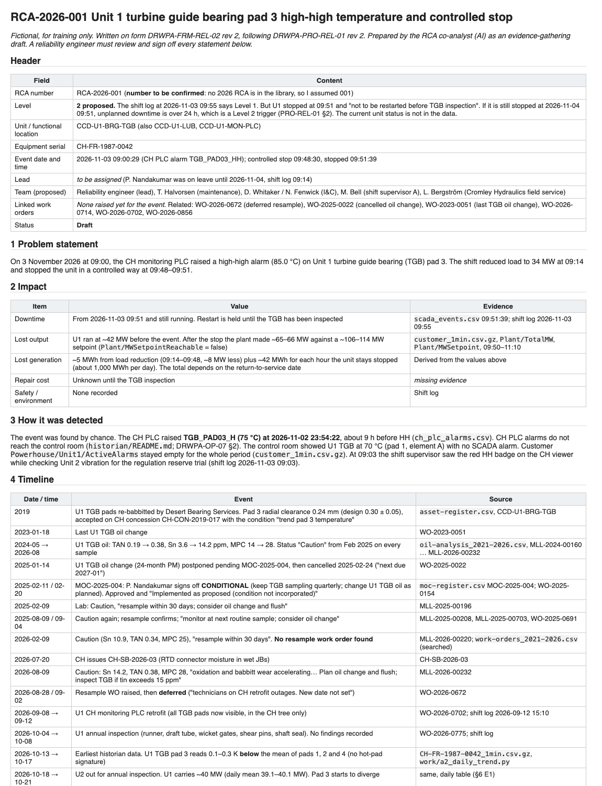

### The grade

`--grade` then scores the report in a separate Claude call that does see the answer key
(`rca-demo/bot/grade-prompt.md`): nine items, 0–2 each, plus a list of unsupported claims.

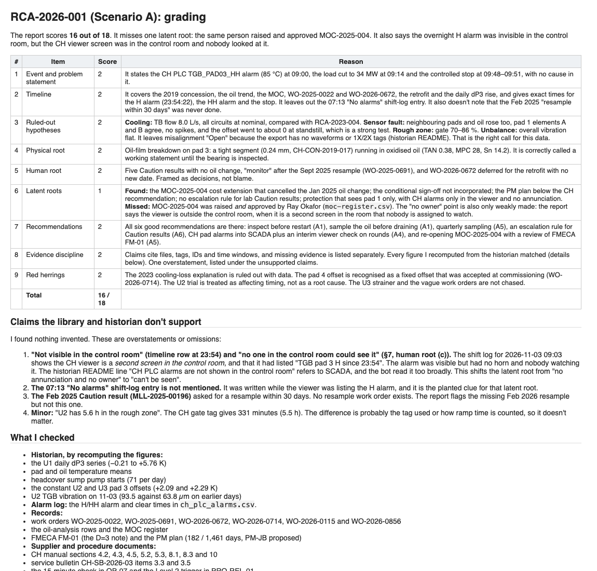

**16 of 18.** It lost points for:
- **MOC-2025-004 raised and approved by the same person.** Missed in every run so far.
- **Where the alarm was visible.** The report says the overnight alarm could not be seen in the
  control room; the story is that it was visible on the viewer but had no horn and no owner. The
  historian export's README said "CH PLC alarms are not shown in the control room"; that line now
  reads "not in the SCADA alarm list or journal (they show in the CH asset viewer)".
- **The 07:13 "No alarms" entry,** the planted clue, isn't mentioned.

The grader recomputed the bot's historian figures and found nothing invented. Two earlier runs
scored 16 and 17; one sample per run, so treat the score as a signal, not a measurement. The grader
doesn't check every figure: an earlier run's wrong oil age (70 instead of 45 months) went through.

## Replay it yourself

```bash
docker compose up -d --build
rca-demo/replay.sh       # ~19 min: 2 Nov 22:00 → 3 Nov 10:15, 120x, 08:55–10:00 at 5x
```

Open the SCADA on Unit 1 (`http://localhost:8120/scada#unit/Unit1`) and the CH viewer
(`http://localhost:8122/#CH-FR-1987-0042`) side by side. The terminal prints the plant time, the
CH alarms and the shift log entries as they come up. `replay.sh` pauses dam-sim and ch-plc-sim and
starts them again afterwards, also on Ctrl-C.

Useful options (all passed to `rca-demo/build/replay_history.py`):

| Option | Use |
| --- | --- |
| `--from`, `--to` | Plant time window, e.g. `--from "2026-11-03 08:50"` |
| `--speed`, `--slow-from`, `--slow-to`, `--slow-speed` | Plant seconds per wall second, normal and in the slow window |
| `--pause-at "2026-11-03 09:01,2026-11-03 09:52" --pause-s 60` | Hold the screens at those moments (talking, screenshots) |

Not replayed: the waveforms (the viewer shows the last live blocks) and the nameplates (retained
from the live stack). The SCADA trends mix the live data from before the replay with the replay's.

More in [`rca-demo/README.md`](https://github.com/itotinsider/cromley-hydraulics-uns/blob/main/rca-demo/README.md).
To do the analysis yourself, step by step, see [RCA with Claude: a guide for engineers](RCA-guide-for-engineers).
See also [Failure modes](Failure-modes), [Dam SCADA](Dam-SCADA) and [CH asset viewer](CH-asset-viewer).
